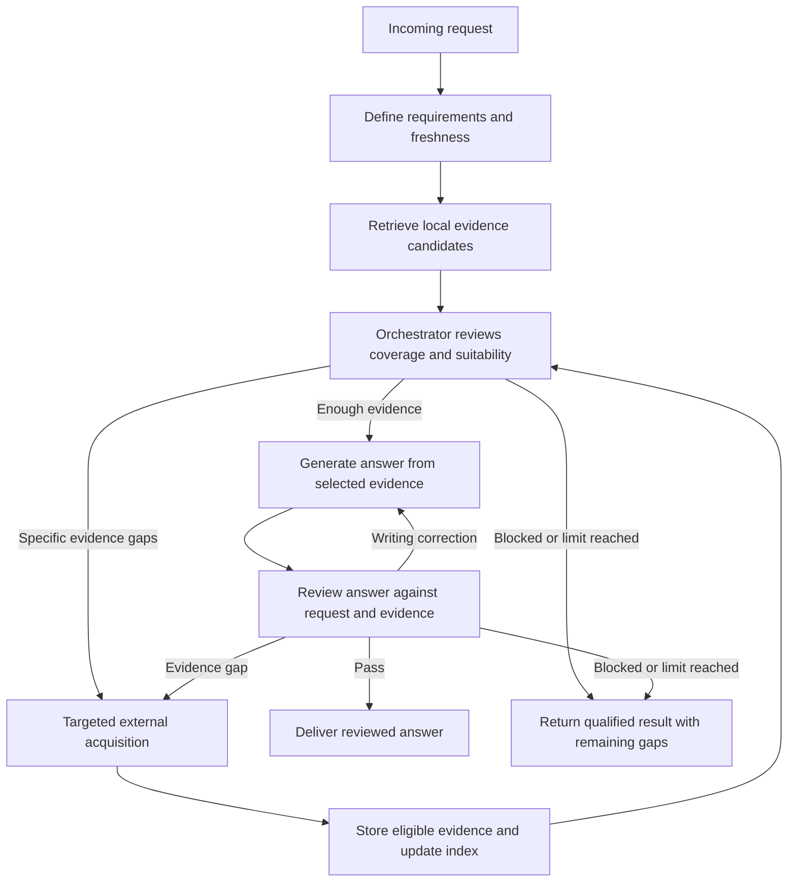
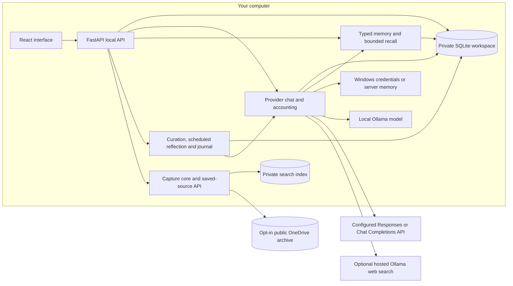

# Maestro architecture

Architectural direction agreed 2026-10-16; implementation checkpoint updated 2026-10-19. Maestro is intended to be a personal AI coordinator that turns requests into bounded, reviewed work and maintains reusable evidence. The research milestone is a factual search database: searches, their returned source material, original versions and decisions about using them. A later curated knowledge database is a separate capability. For research requests, inspect existing source records, establish what is missing or unsuitable, acquire evidence, and review an answer against the original request. Finance and local football are examples of domains using this shared workflow.

This overview defines the target direction and separates it from the implemented runtime below. The [chat design](CHAT_ORCHESTRATION.md) develops assessment, run status and later specialist execution; the [storage design](SEARCH_CONTEXT_STORAGE.md) develops capture, retrieval and archive integrity. The [development plan](../DEVELOPMENT_PLAN.md) tracks delivery and verification. This documentation update does not implement the target workflow or establish that a working-tree change is deployed.

## Target research workflow

The orchestrator owns the original request and its completion criteria throughout the run. Ordinary conversational requests can take a direct-answer route; necessary clarification precedes dependent research. The following branch applies when an answer requires evidence.

1. **Define requirements.** Record the subject/entity, requested facts, relevant dates or reporting periods, acceptable freshness, preferred or required source types, and expected output. Resolve material ambiguity before dependent work. For a stock request, identify the security and distinguish a quote from reported revenue, profit and announcements; record currency and units where applicable.
2. **Retrieve candidates locally.** Keep local retrieval separate from online acquisition. Inspect available evidence even when current information is required, so useful stable or historical material can be retained and exact gaps identified. Retrieval returns candidates with provenance, dates and completeness; a match alone does not establish adequacy. An unavailable or bounded lookup is recorded rather than described as an exhaustive miss.
3. **Assess each requirement.** The orchestrator records selected evidence, support locations, rejection reasons and gaps. Requirements may be covered, missing, stale for this request, conflicting or unavailable. Reuse valid evidence and supplement or refresh the affected parts. An old report may support a reporting-period fact while a quote needs a new observation.
4. **Acquire missing evidence.** A researcher chooses permitted searches or source connectors for explicit gaps. Record attempts and outcomes, obtain useful source content, and distinguish discovery, document retrieval and origin revalidation. Checking an old URL does not discover a newer report elsewhere; a latest-information request may require fresh discovery.
5. **Ingest before composition.** Save eligible acquired evidence and its acquisition metadata before generating the answer, then update derived indexes. A failed answer must not discard a successful capture. Capture failure or disabled saving is explicit; an otherwise permitted transient answer retains its available provenance and `not_saved` status. A requirement for durable evidence remains unmet if saving fails.
6. **Write from selected evidence.** Supply the writer with the request, requirements and relevant evidence passages or structured observations. Preserve source-version references and distinguish source facts, calculations and interpretation. Stored information outside the supplied evidence cannot be claimed as support for that answer.
7. **Review before delivery.** Check fulfillment of the original requirements, support for factual claims, dates, quantities, units, citations and contradictions. Bind claims about performed actions to backend outcomes. A writing problem returns to composition; an evidence problem returns to targeted research. Model agreement and a valid citation identifier alone do not establish support or truth.

Decisions and handoffs should use validated structured records, including requirement IDs, evidence references, reasons, gaps and the next permitted action. Application code enforces permissions, source integrity, budgets and state transitions. Model assessments supplement those checks. This is a target contract; exact schemas and API changes belong to implementation increments.

### Responsibilities and model roles

| Responsibility | Owns | Initial implementation direction |
| --- | --- | --- |
| Orchestrator | Request requirements, coverage decisions, next actions and final acceptance. | Explicit assessment and review stages with recorded decisions. |
| Evidence / DB service | Retrieval, validated ingestion, versioning, indexing, deduplication and provenance. | Deterministic application services; a model may propose extractions but does not freely mutate storage. |
| Researcher | Queries, source selection and acquisition for specific missing evidence. | Model-directed tools and configured source connectors within the run's permissions. |
| Answer writer | A coherent answer from the selected evidence and original requirements. | A separate composition stage with an explicit evidence packet. |
| Verifier | Requirement fulfillment, claim support, freshness and contradictions. | Initially an explicit orchestrator review phase; a separate reviewer model is optional. |

These are logical responsibilities, not a requirement for five models, independent conversations, processes or specialist child jobs. Start with sequential inference through the existing generation service. The same installed model can serve several roles with distinct instructions and selected context. Evaluate a different reviewer or specialist where it improves measured outcomes. The evidence workflow does not depend on implementing general task delegation first.

### Shared limits in code and agent instructions

The application owns one cumulative allowance for the whole research run, not a fresh allowance for each stage. Before each assessment, acquisition, writing, review or revision, it checks and reserves the remaining calls, tokens, time, estimated model spend and permitted hosted searches. Keep the initial one-hosted-search/run limit and the shared configured daily allowance of at most 20 during this rollout, honoring lower user settings. Reserve enough allowance to finish composition and review before optional further work. Foreground run ownership spans stage boundaries so another stage cannot accidentally start an independent budget or let background work take its reserved place.

Every necessary model stage receives a server-authored snapshot relevant to its assignment: the shared objective, completed/remaining work, total limits, cumulative consumed/reserved amounts, remaining allowance, deadline and available actions. Instructions tell the model to choose a useful next action within that allowance and report a gap when it cannot finish. Do not provide private keys, unrelated accounting history or unnecessary personal context. Application code recomputes authoritative balances at dispatch; a model cannot raise a limit, reset a counter, grant permissions or authorize a call by claiming that resources remain.

Keep actual token/call/search counts separate from money estimates. Model charges use the existing recorded pricing and usage; unknown hosted-search charges remain unknown and are not reported as free. Local model API charges do not estimate hardware or electricity. Extend the existing generation service with a narrow owned research-stage contract before the first typed stage, rather than impersonating a reflection job or adding another provider client. These are target requirements, not claims about the present per-call runtime.

### Completion, revision and runtime ownership

A fully satisfied result meets every mandatory criterion to its specified standard, including any qualification the request permits. An unavailable required item produces a terminal partial or inability-to-verify outcome, not full acceptance. Approval must refer to those criteria rather than an unrecorded judgment that the agent is satisfied. Conflicting evidence remains visible and may justify further research or a qualified result.

Every iteration must have a specific purpose: acquire evidence for a named gap or correct an identified answer defect. Enforce run-wide search, call, token, time and spend limits in application code and reserve allowance for final composition and review. Stop when the criteria are met, the user cancels, permitted resources are exhausted, a dependency is unavailable, or another round yields no useful progress. An unreviewed draft must not become an approved answer merely because the limit was reached; return a truthful partial or inability-to-verify result.

Persist the run's requirements, attempts, decisions, selected evidence, review outcome and actual stage transitions in private storage. Cancellation, reconnect and restart must not duplicate external acquisition or final answers, and stale attempts cannot commit. Uncertain external outcomes remain explicit. Extend the existing ownership and accounting contracts before introducing an independently dispatching worker; see the [chat runtime design](CHAT_ORCHESTRATION.md).

## Target factual search and source storage

Preserve the separation between private local databases and immutable source content. Keep canonical search, result, run and decision records in durable private tables, complete eligible acquired content in the archive, and derived keyword indexes in rebuildable local storage. "Factual" identifies source material to assess, not a claim that every source statement is proven true. A separate database per role or domain is unnecessary. The following are logical records, not a committed SQL schema. Source-linked observations and entity annotations can enrich the factual records later; an autonomous consolidated knowledge/memory database is outside the initial search rollout and must not block it. Existing private user memory remains a separate subsystem.

| Record | Essential information |
| --- | --- |
| Research run and requirement | Original request, subject, facts requested, relevant period, freshness/source criteria, coverage, decisions and final outcome. |
| Acquisition attempt | Query or requested resource, provider, relevant parameters, intent/requirement references, attempt time, status, returned references and failure or limit reason. |
| Source and source version | Stable source identity, exact observed locator/provider ID, publisher when known, content reference/hash, acquisition method, dates and completeness. Preserve observed URLs when normalizing identities. |
| Evidence item or observation | Supporting passage or structured value, subject, metric, units/currency, applicable time/period, source-version reference and support location. Retain extraction method/version for derived records. |
| Entity and relationship | Stable identity, type, aliases, topics and typed connections, with supporting evidence or an explicit inferred-association basis. |
| Answer and review provenance | Evidence actually supplied to the writer, claim/support references, calculations and inputs, review findings and backend action receipts. |
| Derived index | Searchable text and later measured retrieval enhancements, rebuildable from canonical records and source versions. |

Document identity, content identity and acquisition identity are distinct. Identical bytes can share one content object while recurring acquisitions preserve their own timestamps and provenance. Changed content creates a new saved version. A new version does not rewrite an earlier answer's evidence. Canonical search links, annotations and review decisions must survive an index rebuild. Generated answers and summaries are derived artifacts linked to evidence; they do not become independent primary evidence by being stored.

### Proposed OneDrive archive and local working files

Use a fresh proposed source-file root at `C:\Users\malme\OneDrive\Maestro-SearchArchive`. The earlier scaffold/archive can be ignored by the revised implementation; no automatic import, move or deletion is implied. This path is a proposal for implementation, not an already-created folder or a runtime configuration change. Keep the private live SQLite databases, search/query mappings, run/accounting records and derived indexes in the configured local Maestro data directory outside OneDrive and Git. The index may consume additional local space beyond the archived files.

OneDrive is cloud-backed synced storage, not additional local disk or model memory. Files created on the PC initially consume local disk; reading an online-only file downloads it. Files On-Demand can later release local file contents while retaining cloud files, whereas "Always keep on this device" retains a local copy. Newly acquired files therefore still require free local staging space, and cloud quota does not remove local disk constraints. Keep archive lookup bounded so a metadata listing cannot accidentally download the collection. See [Microsoft Files On-Demand](https://support.microsoft.com/en-us/onedrive/save-disk-space-with-onedrive-files-on-demand-for-windows).

Expose separately the archive's logical bytes, actual locally allocated bytes when measurable without hydration, local index/staging usage, free local disk and known sync/availability state. Cloud quota and cloud upload completion require their own verified observations; a configured allowance or filename is not evidence of either. The user's estimated cloud capacity is not a verified quota and should not become a hardcoded allocation. Exact archival/local-cache allowances can be chosen from observed capacity during implementation. Compression and automatic local-cache management are later optimizations.

### Content acquisition and model context

Store as much complete useful acquired evidence as reasonably permitted by eligibility, free space and configured acquisition/archive limits. Warn about unusually large payloads rather than imposing an arbitrary tiny excerpt limit on storage. Retain finite configurable hard protections for extreme response/document sizes, decoded/extracted growth, processing time and minimum local free space; warnings alone cannot prevent an out-of-memory or full-disk failure. Refusals, partial captures and known truncation must be explicit. These source-file protections are independent of the model's input allowance.

Keep complete eligible provider content independently of the smaller passages selected for a model. Record whether content is a search excerpt, provider-extracted page, original document or structured API response; record known truncation and extraction limitations. A search snippet is a discovery lead and may support only the limited claims it actually contains. The archive does not need semantic indexing, model-generated compression or file compression to become useful.

The local integration working tree already archives complete sanitized search extracts before fitting model evidence to at most 1,200 characters per source; not all of this is merged on main. That prefix limit describes what the model receives, not the intended archive capacity. Replace it in the revised path with bounded requirement-relevant passages selected anywhere in the saved text. Preserve validated source offsets, capture/content hashes and passage hashes, and use the same selected packet for coverage, writing and review. Preserve legacy prefix-based follow-ups while their callers migrate. A fixture must find and reuse support beyond character 1,200 without a hosted search. Increasing storage, result count or context alone does not turn snippets into complete original documents. Ollama exposes separate search and page-fetch capabilities; its fetch response contains main page content rather than an original-byte archival contract. See [Ollama web search and fetch](https://docs.ollama.com/capabilities/web-search).

Preserve original response/document bytes when an acquisition method actually provides them, extracted readable content separately, and extraction versions so derived material can be regenerated. Full-page/PDF acquisition needs the transport and parser boundaries in the [storage design](SEARCH_CONTEXT_STORAGE.md#full-source-downloads). Never relabel an older excerpt as a full document or regenerate missing historical bytes from a current page.

### Freshness and historical value

Treat `stale_after` as a best-before date: evidence may need checking before it supports a current-information answer, but remains stored and can still support historical questions. Freshness is suitability for a particular requirement, independent of retention. Use information-type and domain policies rather than one universal reuse window. Set actual durations later; the minimum early policy preserves known dates/periods and treats unsupported currentness as a gap.

| Field | Meaning |
| --- | --- |
| `retrieved_at` | When Maestro acquired the observation; local reuse does not reset it. |
| `published_at` / `modified_at` | Source-reported dates when known, with their basis and precision; unknown dates remain unknown. |
| `as_of` / reporting period | When a claim or structured value applies. Different observations in one document may have different periods. |
| `last_verified_at` | When a particular source representation or observation was checked again, with method and outcome. Revalidation does not independently prove factual truth. |
| `stale_after` | A policy-derived threshold for requiring refresh for a specified use, with the relevant policy/version or requirement context. |

Fetching an old article today does not make its contents current. A past financial report can remain useful for a historical request after becoming unsuitable for the latest-results requirement. Quotes, reporting-period figures, future fixtures and completed match results need different policies. Explicit source modes, fresh-search instructions and no-search instructions remain enforced; inspecting saved metadata must not silently replace a required fresh acquisition or authorize a forbidden one.

Repeated checks and newer observations can mark an earlier record stale, superseded, obsolete or disputed, with the reason and supporting version retained. Preserve the old bytes and their dates rather than overwrite them. Derived publication/validity assessments belong in private records referencing immutable captures, or a deliberately versioned new format with backward readers; do not rewrite old manifests pinned by earlier answers. Eviction is a separate future process that may consider very overdue stale dates, confirmed obsolescence, space pressure and dependencies. A stale date, new contradictory result or code refactor does not by itself authorize physical deletion. No automatic eviction is part of the first rollout.

### Three separate cleanup decisions

| Kind | What changes | When and why |
| --- | --- | --- |
| Program-code retirement | Remove unused old routing, prompts, adapters and duplicate UI after replacements and callers pass checks. | During each replacement PR and a final removal-only gate, to keep one maintained implementation. Does not delete saved source or memory records. |
| Local-copy release | OneDrive releases downloaded contents while retaining the cloud file. | A separate future local-cache policy or user action after sync/availability checks, to recover local disk. This is not archive deletion. |
| Archive eviction | Remove retained source versions/content according to reference-aware retention rules. | A later explicitly configured process; may consider very overdue best-before dates or demonstrated obsolescence. Keep reasons/history and protected references. No automatic source-file deletion now. |

### Reuse and unnecessary-search prevention

Separate evidence reuse from acquisition deduplication. Evidence reuse asks whether existing observations satisfy a requirement. Acquisition deduplication asks whether an equivalent permitted search or fetch was recently completed or is already in progress.

Compare entity identity, requested metrics, relevant period, freshness requirement, provider and material parameters. Query text alone misses equivalent requests; semantic similarity alone can incorrectly merge different securities, currencies or periods. Record recent and in-progress attempts and their outcomes, and share acquisition results only when each request's criteria and privacy scope permit it. A failed or empty search must not suppress needed research indefinitely. Preserve source timestamps when reusing results.

### Domains, table view and graph view

Finance, football and future domains initially share this evidence model and run pipeline. Configure their preferred sources/connectors, terminology, freshness rules, extraction schemas and review criteria. Introduce separate specialist agents when their work requires a distinct capability or materially different workflow; avoid isolated databases that prevent shared entities and evidence from connecting.

Provide two views over the same canonical records:

- **Table:** inspect source/version to stored content and extracted observations, linked searches, relevant dates, completeness, freshness for a selected use, and answer usage. Support filtering and opening the exact saved version.
- **Graph:** begin with domain -> source URL -> saved capture/version links from existing metadata. Add recorded request/run -> search/acquisition -> exact source-version links when #23/#28 supply them; missing historical provenance stays unknown. Later add source-backed entity/topic annotations and observations, such as company -> issued -> financial report or club -> participates in -> competition, when those records exist. That later enrichment is not a prerequisite for the factual search store or its first graph.

Selecting a node or edge should expose its source/version, supporting passage or derivation, relevant dates and review status. Visually distinguish sourced relationships from inferred topic associations. An associative edge is useful navigation, not factual evidence by itself. The existing private-memory map remains a separate view and does not already implement this research graph.

A graph UI can use ordinary entity and edge tables in SQLite; adopting a graph database is not an initial requirement. Retain the current keyword index, and add semantic retrieval or graph infrastructure only when measured retrieval misses, traversal needs or scale justify them.

### Frontend composition and visible increments

Follow the composition used by the Argus Stock page: a small page entry arranges domain sections, cohesive hooks own data/request state, and reusable presentation components receive narrow parameter props and callbacks. Use JS/JSX for new React pages/components and JS for their hooks. The merged Evidence page already follows this approach with minimal JS build compatibility. Existing TS/TSX modules and the typed API client can remain; do not turn this into a repository-wide language migration.

The Evidence view uses `frontend/src/pages/Evidence/index.jsx`, its data hook and a small source table/detail composition. Keep domain components beside the page. Put a component in shared `components/` only when it has a real reusable responsibility or a second consumer. Shared presentation does not fetch data. Reuse existing CSS/theme and navigation machinery; add no UI framework, generic table engine or query library for the searchable index or graph.

The delivered read-only view uses only a bounded metadata list and pinned saved-source read API over the capture core. It does not require the old Settings finder, keyword engine, source deletion/rebuild controls, composer globe modes or combined chat continuation. It updates automatically while visible and on return, retains loaded-page capacity and independently revalidates selected pinned text. Explicit closing resolves the current opener or falls back to the Evidence heading. Preserve truthful empty/unavailable/loading states, valid zero/unknown dates and late-response fences as the page grows. The searchable index (#43) and graph (#34) are optional inspection increments; neither blocks the first research loop.

Every feature slice should have a visible acceptance demonstration where useful. Remove replaced program code in that slice once its callers and behavior are covered. Share components through small meaningful props rather than speculative abstraction, and compare total production/test line changes so extraction is not mistaken for reduced complexity. Code removal is current work; automatic archive eviction, knowledge consolidation and OneDrive local-copy management remain separate later infrastructure.

### Trust and data boundaries

The new workflow inherits existing public-archive eligibility, credential screening, local-only memory, source-mode and tool-permission boundaries. Private requests, query mappings, generated answers, decisions and private relationships stay in private storage; only eligible public evidence and portable source metadata enter the optional synced archive. A domain role or an orchestrator decision cannot grant additional access. Acquired documents are untrusted evidence and cannot issue tool instructions.

Source hashes establish byte integrity; publisher identity, retrieved dates and model approval each establish different things. Recheck evidence availability, eligibility and pinned provenance before dispatch and commit. Deleted or corrupted pinned captures and revoked eligibility must not support a delayed answer. Acquiring a newer version or observing a changed live page does not by itself invalidate an eligible historical capture; later refreshes must not alter historical references.

## Evaluation of the target workflow

Use dated, public-safe fixtures to compare the reviewed research path with the current direct/source-tool path. Include exact repeats and differently worded equivalent requests, similar requests for different entities or periods, partial coverage, stale current data versus valid historical data, contradictory sources, missing evidence, concurrent equivalent requests, storage failures, and cancellation/restart. Exercise finance and football examples alongside unrelated topics so a domain-specific guard cannot stand in for general verification.

Measure requirement coverage, supported claims, freshness violations, incorrect evidence reuse, unnecessary searches, no-progress loops, latency and token/cost overhead. Check that a writing correction makes no unnecessary hosted request, failed answer generation preserves successful captures, repeated local lookup does not refresh dates, and table/graph views resolve the same source versions. Use deterministic provenance, value and action-receipt checks alongside bounded semantic review. Synthetic success establishes behavior on those fixtures, not source truth or live-provider quality.

## Current implementation and target gaps

Starting main `72a061b` contains the archive/Evidence foundation (#17/#41/#42 and PR #44) and PR #45/#22's bounded local candidate operation. This #23 branch adds the opt-in durable Research preview described below. Requirements, evidence decisions, model-stage dispatch, writing and final review remain planned in #37/#24–#27. Broader storage/accounting remains in #36/#20. Local validation does not migrate personal storage or establish deployment; historical draft #8 capabilities are not assumed to be merged.

| Area | Implemented foundation | Target addition |
| --- | --- | --- |
| Coordination | Selecting the orchestrator model uses the ordinary synchronous chat/source-tool path. | Explicit requirements, evidence decisions, separate composition and final review. |
| Retrieval and acquisition | One hosted-search round in chat. Merged #22 provides separate bounded, verified local candidates. This branch records local preview lookup receipts. | Per-requirement evidence review, then targeted acquisition; chat reuse remains unwired. |
| Storage | Capture core, immutable objects, private catalogue/query records, configuration/ownership, pinned read APIs and visible archive settings/status. Chat does not yet call archive capture. | Complete-content/capacity/accounting follow-ups (#36/#20), container archive setup, research run/decision records and later observations. |
| Freshness and verification | Pinned byte/manifest integrity and current credential/eligibility checks; publication dates remain unknown. Local candidates retain original dates with a mechanical reuse-window stale flag. | Date/period suitability, best-before policies, claim support and request-fulfillment review; a match or non-stale flag does not establish acceptance. |
| Inspection | Read-only Evidence table/detail with automatic updates; private-memory map remains separate. | Searchable index (#43) and bounded provenance graph (#34), optionally enriched later. |
| Execution | One generation slot, shared accounting, reflection jobs and this branch's durable local research preview. | Owned model stages (#37), then reviewed answers; general task execution and specialist delegation remain later work. |

The following sections describe the merged runtime plus this branch's durable local preview. The [storage design](SEARCH_CONTEXT_STORAGE.md#local-candidate-lookup-22) defines the merged candidate contract and separately labels older draft/preview behavior, including cache modes, source replay and multi-lookup continuation. None of those historical paths is a prerequisite to merge wholesale.

### Durable research preview (#23)

The explicit **Research** view submits an original request (up to 32,000 characters), optional local keywords (512 characters) and an originating chat ID. A client-generated submission ID identifies one immutable submission; retries return that run without scheduling another callback. Reusing the ID for different content is rejected. The request, privacy scope, allowance, bounded ordered events and exact saved-version references live only in the private workspace SQLite database. No source body, title or URL is copied into the run receipt.

Admission shares the existing immediate SQLite reservation lock with provider generation. Request/query and client identity fields are screened before saving; a final whole-record check inside admission combines initial/current credentials and rolls back rejected run/event/duplicate-guard inserts before commit. One queued/running research run excludes unrelated chat, title and reflection inference; existing reserved or uncertain provider usage prevents a new research run. An in-process post-response callback claims the run once, executes the existing bounded local candidate operation and records a terminal **partial** receipt. It makes no model or hosted call. Only submission, actual local lookup and terminal transitions appear; no requirements, evidence acceptance, writing or review is simulated. Source dates and stale labels remain mechanical candidate metadata.

Server-captured allowances contain calls, tokens, elapsed time/deadline, estimated model spend and hosted-search counts, each with total/consumed/reserved/remaining amounts, complete parent workspace limits and a shared daily-search snapshot capped at 20 or a lower user setting. Preview caps are four model calls, the parent's token/run-spend caps, 120 elapsed seconds across local clock changes and zero hosted calls; actual non-time usage remains zero. The existing controller expires overdue queued/running ownership even when optional reflection is disabled. It retries maintenance after transient storage failures without redispatching research, preserves reservations and current privacy restrictions, and fences late commits. These stored model allowances do not authorize dispatch: #37 must add cumulative reservation, settlement and finishing capacity before enabling any model stage. Hosted prices remain unknown and local inference spend excludes hardware/electricity.

The preview recalls no memory and permits only saved evidence. It preserves the originating conversation's memory-derived restriction, including restrictions added before a terminal commit. Claim tokens and terminal state fence late work after cancellation or deletion. Deleting a run or its chat clears private payload/events and retains only opaque identity/fingerprint guards against duplicate dispatch; it does not delete saved source files. Startup marks queued/running runs **interrupted** and never schedules them again. Provider uncertainty stays in the existing accounting ledger.

Authenticated reads screen raw request/query and identity fields as well as serialized metadata against current credentials, and revalidate every returned reference's content/manifest pins and source eligibility. One read-only SQLite snapshot keeps selected IDs, records and events consistent during concurrent run/chat deletion. Unavailable references are withheld with an explicit count; unsafe private records are hidden. Receipt summaries describe the recorded lookup outcome, including disabled/unconfigured archives and incomplete inspection; older receipts receive the same wording on read without rewriting history. Limited results do not necessarily mean a work cap was reached. Reuse-window flags describe the original lookup, not current freshness. Visible polling restores recorded activity after reconnect. Overlapping interval/focus refreshes coalesce so slow reads can finish, while selection/mutation/unmount revision fences discard late responses. Browser session storage contains only opaque pending identity. Ordinary chat routing is unchanged. This increment introduces no independent worker service or provider stack.

## Implemented boundaries

The built frontend is served by FastAPI on one loopback origin. Workspace contains chat, Tasks contains attributed to-dos, Memory contains its separate map/list and reflection journal, and Evidence browses saved source metadata and exact text versions. Settings configures models, credentials, search, reflection and limits. The header and usage view report actual model usage and estimated spend.

`backend/app.py` owns session/CSRF protection, validation, CRUD and application lifespan. `backend/provider.py` owns the single connection, shared generation slot and usage ledger. `backend/reflection.py` owns durable idle jobs and reviewed memory/working notes. `backend/work_config.py` validates task models and worker policy; `backend/memory.py` owns accepted records and read-only recall. `backend/web_search.py` owns hosted search readiness and limits. `backend/context_store.py` owns capture eligibility, immutable objects/manifests, private indexing, bounded metadata listing, pinned readback and archive ownership. Inventory reads do not repair or initialize storage; an explicit write-side setup maintains the ordered pagination index. SQLite writes use immediate transactions; generation runs outside locks. One worker runs inside the sole API process under exclusive workspace ownership.

Ollama uses its native loopback API, accepts installed local models and has no cloud fallback. Other adapters use Responses or Chat Completions. The UI always uses the chat role. Saved `chat_routing` selects the direct chat default or configured orchestrator model for local chat; a blank orchestrator selection uses the chat model and an explicit per-message choice wins. Existing connections default to direct routing. Coordinator instructions use the existing source-tool path, without another assessment call or specialist dispatch. Chat sends the selected conversation and optional local memory; the frontend progressively reveals the completed backend reply and renders safe Markdown. Reflection receives explicitly selected bounded evidence/memory, without implicit recall, tools, hosted search or conversation titles. Chat curation forms then reviews facts/preferences; scheduled reflection forms then reviews identity/lesson notes. Both use one shared slot and at most two calls.

Chats have stable IDs, separate message lists and editable titles. Workspace responses include chat summaries, `active_chat_id` and the selected chat's messages; generation captures an explicit chat ID. New chat preserves existing conversations. Deletion removes a chat's content while retaining the shared usage ledger, and is blocked while that chat has a reserved request. Previous live history migrates once into one conversation. Projects remain a later feature.

Manual task creation, completion/reopening, suggested-assignee changes and deletion only update local records. The server assigns immutable `initiated_by` (`user` or `maestro`); `suggested_assignee` uses the same values and remains editable. Older records expose `user` defaults without rewriting storage on reads.

Periodic reflection receives a server-authored capability overview and improvement goals alongside current practices and optional exchanges. `backend/capabilities.py` shares declared capabilities with the workspace API. It may propose useful practices or experiments without chat evidence; prompts distinguish untested ideas from observed outcomes. The journal records this assessment basis without inventing source messages or feeding journal prose back as evidence.

With `auto_create_tasks` enabled, periodic reflection may propose at most two follow-up or self-improvement tasks in its existing formation call, and the independent reviewer approves task indices in its existing second call. Approved tasks enter the same list in the final checked transaction; no extra model call or approval queue is added. Existing open/completed titles and bounded hashes of deleted AI titles suppress repeats. A suggested assignee is a label, not a dispatch instruction. There are no tools for task execution, repository changes, integration access or agent handoffs.

## Generation and usage

1. Read the active model configuration and the requested chat's context.
2. Check context/output token limits and configured spend allowances. Reserve conservative estimated usage in an immediate transaction.
3. Dispatch one generation, or the bounded Ollama search flow described below. The reservation permits one request at a time across chat and explicit-context calls.
4. Persist the reply and settle provider-reported token usage with the configured price snapshot. After a chat's first successful exchange, optionally generate its title once with the original model and remaining request allowance. The title call uses a bounded first message and no tools, and is skipped if model settings change. Failure keeps the first-message fallback and the successful reply; a manual rename wins over a delayed generated title. Unknown paid title usage still requires reconciliation.
5. Keep unresolved paid usage reserved until the user verifies and reconciles its amount. Known access/quota rejections and confirmed local failures release their reservations. Local chat, titles, and background calls with unknown completion retain a zero-cost slot. Only an explicit acknowledgement that the original Ollama server was restarted, followed by an empty model check on that original endpoint, releases the interrupted request. Loading and queued work can be absent from the model list, so it cannot acknowledge termination automatically. Recovery rechecks request ownership and endpoint under the ledger lock and never releases an active foreground call or reflection phase.

Local model API charges are zero; hardware and electricity costs are outside this accounting. Remote charges are estimates from saved prices, not invoices. Earlier entries keep their recorded prices. An API restart marks interrupted paid requests uncertain. This startup recovery assumes there is no independent live worker and must change before cross-process dispatch is enabled.

## Optional search

When automatic search is enabled and a separate search key has been tested, a tool-capable local Ollama model may request one `web_search` round. The backend calls only `https://ollama.com/api/web_search`, supplies bounded untrusted excerpts and performs at most one final answer-model continuation. Both model calls share the reply allowance and accounting. Query/source links persist beside the answer; main does not yet look up saved evidence or call archive capture from this flow.

Search tests and dispatched failures/interrupted attempts count toward the configured daily cap. One in-flight search, five-second spacing, a 30-second timeout, response-size limits and provider cooldowns apply. Failed attempts are not automatically retried. The default daily cap is 20; the reviewed-research rollout retains 20 or a lower user setting. A one-time title call may use remaining allowance. Result pages are not fetched. Hosted search fees remain unknown and excluded from local inference's zero API charge.

This is a bounded tool call inside chat. It does not delegate a task or create an autonomous agent.

The separate opt-in [capture core](SEARCH_CONTEXT_STORAGE.md) can save eligible public excerpts in immutable files, deduplicate content and maintain a private catalogue/FTS. Configuration defaults are disabled `all_public` capture with 10 GiB/200,000 file-and-directory allowances; persisted restricted policies remain unchanged. Configuration, metadata listing and pinned text APIs are merged. They screen current credentials and enforce source eligibility without changing saved bytes. Evidence uses these read APIs, makes no hosted/model calls, and treats inventory metadata as unverified until opening the exact version. Local search/reuse, automatic chat capture, full-document downloads and automatic retention remain future work.

## Private state and credentials

Tasks, live messages, typed memories, reflection journals, limits, settings and ledgers live in SQLite outside the checkout. The default directory is `%LOCALAPPDATA%\Maestro\preview`; `MAESTRO_DATA_DIR` must also resolve outside the repository. Provider/search credentials live in Windows Credential Manager, server memory or mounted secret files. The OpenAI endpoint can use a server-environment key fallback. Read APIs expose credential presence, never values.

The separate `MAESTRO_CONTEXT_ARCHIVE_DIR` holds only eligible public source excerpts and portable metadata under the enabled capture policy. Queries and capture references stay in the workspace database; the private index lives alongside it at `context/index.sqlite3`. Neither private workspace data nor a live SQLite file belongs in the synced archive. PR #44's first #36 slice documents native setup and verifies app restarts against unchanged disposable paths; container archive mounting remains later work. Local candidate lookup performs no writes or initialization. Documentation does not change active paths.

The API validates Host and Origin, requires a local session and protects mutations with CSRF checks. Remote provider requests send the selected conversation history to that provider; Ollama sends it to the local server. OpenAI requests set `store: false`. The repository and synthetic test fixtures contain no private workspace records or personal credentials.

Earlier prototype-only records remain archived in the private database, and old reflection tables remain inactive. Simulated messages are excluded from active chat and provider context. Private memory uses a separate table with typed origin/provenance metadata, save/edit/pin/forget and bounded local recall. Optional automatic curation protects human edits and records changes in a private journal. Memory-derived conversations cannot later dispatch to remote providers or active hosted search. The [memory/reflection design](MEMORY_AND_REFLECTION.md) documents formation/review, persistent schedules, correction and deletion boundaries.

The memory map is a frontend view of those records: type groups, bounded selectable nodes, search/scope filters and existing source references. It shares editing and forgetting with the list view and requires neither another database nor model inference. Recorded source dependencies describe how a memory was derived; they do not establish semantic similarity.

## API surface

| Routes | Purpose |
| --- | --- |
| `GET /health`, `GET /api/session` | Local health and session/CSRF setup. |
| `GET /api/workspace?chat_id={id}` | Chat summaries, selected messages, tasks, limits, shared usage and capability status; selection is optional. |
| `POST /api/chats`, `PATCH /api/chats/{id}`, `DELETE /api/chats/{id}` | Create, rename or delete a conversation, retaining accounting. |
| `POST /api/tasks`, `PATCH /api/tasks/{id}`, `DELETE /api/tasks/{id}` | Create a user-initiated task; change completion/suggested assignee or delete it. Initiator is server-owned. |
| `POST /api/chat` | Generate a reply for the submitted `chat_id` and persist it in that conversation. |
| `POST /api/research/runs` | Idempotent opt-in local preview submission; capture parent allowances/privacy, return 202 and schedule one claimed local lookup. |
| `GET /api/research/runs`, `GET /api/research/runs/{id}` | Up to 50 recent metadata records (no events/receipt) or one recorded activity/receipt; current credential and exact-source fences, no automatic execution. |
| `POST /api/research/runs/{id}/cancel`, `DELETE /api/research/runs/{id}` | Terminal cancellation or private-record deletion with late-commit and duplicate-submission fences. |
| `PATCH /api/chats/{chat_id}/messages/{message_id}/feedback` | Save/edit/clear an optional rating and comment on an existing answer, without inference. |
| `GET /api/memory`, `POST /api/memory`, `PATCH /api/memory/{id}`, `DELETE /api/memory/{id}` | Inspect, save, edit/pin or forget private memory; snapshots also include records. |
| `GET /api/work-config`, `PUT /api/work-config` | Saved task models, recall allowances and reflection enable/pause policy. |
| `GET /api/reflection` | Read-only worker status, daily usage, current memories, journal and legacy proposals. |
| `POST /api/reflection/candidates/{id}/accept`, `DELETE /api/reflection/candidates/{id}` | Accept a source-backed proposal into scoped private memory or reject it. |
| `GET /api/provider`, `PUT /api/provider`, `POST /api/provider/test`, `DELETE /api/provider/key` | Active connection settings including local chat routing, model-list access and credential removal. |
| `POST /api/provider/charges/{id}/reconcile` | Settle a provider-verified uncertain amount. |
| `GET /api/web-search`, `PUT /api/web-search`, `POST /api/web-search/test`, `DELETE /api/web-search/key` | Search readiness, settings and separate credential lifecycle. |
| `GET /api/context`, `PUT /api/context` | Archive readiness, validated configuration/scopes, storage limits and ownership lifecycle. |
| `GET /api/context/sources` | Bounded read-only metadata pagination with opaque continuation; no source-body read, repair, model or hosted request. |
| `GET /api/context/sources/{id}` | Open a saved excerpt with required content/manifest hashes; verify exact bytes, eligibility and current credential screening. |
| `POST /api/context/search` | Merged #22: bounded local exact-query/literal-keyword candidates, optional exact domain and inclusive UTC retrieval-date filters. Verify saved bytes/pins, eligibility and current credentials; preserve dates and mechanical stale labels. No lookup writes, model or hosted call; no freshness-acceptance verdict. |
| `PUT /api/limits` | Save the enforced chat spend/token allowances. |

## Next build sequence

The [Podman deployment checklist](../DEVELOPMENT_PLAN.md#podman-deployment) runs alongside this functional sequence. The [container runbook](CONTAINERS.md) covers one application container, persistent private storage and host Ollama. Native and container runtimes acquire an exclusive workspace lock before recovery; keep one API owner per workspace until worker ownership and leases are implemented. Local chat and planning roles can choose distinct models through the same reservation ledger; named endpoint profiles and task routing remain separate work.

The shared generation foundation is implemented: `Provider.generate_context` accepts bounded selected context and an installed local model through the same ledger as chat, without tools, titles or chat persistence.

Architecture [PR #40](https://github.com/erikmalm/maestro/pull/40), #17/#41/#42 and PR #44's first [#36](https://github.com/erikmalm/maestro/issues/36) setup/status/restart slice are merged, and baseline #35 is complete. Old integration #8 and its fixture PR #39 are closed as superseded. Synthetic sources belong in a separate disposable store, without populating or migrating personal storage. The normal archive may remain empty until acquisition is wired. Do not import or delete the earlier scaffold. This branch adds #22 local candidates without waiting for the remaining #36/#20 storage/accounting refinements.

After local candidates ([#22](https://github.com/erikmalm/maestro/issues/22)), complete the first saved-source research pipeline: owned runs (#23), shared model-stage/allowance contract (#37), requirements and evidence decisions (#24/#25), then writer and final review (#26/#27). Keep minimum date/best-before reasoning and relevant saved passages in that path. Code and model instructions share cumulative limits. Live stages appear only when recorded. Routine checks and small intended-local-model trials use fixed sources without hosted searches.

A searchable Evidence index ([#43](https://github.com/erikmalm/maestro/issues/43)) and recorded request/search/source-version graph ([#34](https://github.com/erikmalm/maestro/issues/34)) can proceed in parallel or later; they do not gate a functioning research loop. Entity annotations (#33), a graph database engine and curated knowledge remain separate later choices. Controlled acquisition (#28–#30) follows the attempt journal and initially permits one hosted search/run within 20/day or a lower user limit. Validate routing/caller migration (#38) before final obsolete-code removal (#31), preserving private memory and source content. Full documents, compression and automatic eviction remain later policies. [Tracker #18](https://github.com/erikmalm/maestro/issues/18) owns the detailed dependencies.

The [development plan](../DEVELOPMENT_PLAN.md#next-delivery-sequence) owns delivery and acceptance. [CHAT-01 and CHAT-02](CHAT_ORCHESTRATION.md#implementation-increments) supply status and assessment foundations; the research branch adds the evidence decisions and final-review stages described here. CHAT-03 and CHAT-04 remain later specialist increments. Bind source claims to evidence and action claims to backend outcomes before broader acquisition or delegation; model agreement alone is not verification. Exact schemas, thresholds, migrations and graph technology are implementation decisions to validate against this overview.

Task execution requires durable claims, leases and ownership-aware recovery: API restart must not release a live worker's reservation, and stale attempts cannot commit after a newer claim. Descendants share the parent's bounded context, tools and call/token/time/spend allowance, with cancellation and no-progress stops. A first local specialist can reuse saved model choices once attempt ownership works; named profiles broaden routing afterward. Explicit memory and [durable background reflection](MEMORY_AND_REFLECTION.md) are already usable independently; automatic promotion, scheduled notes and reviewed task suggestions are optional, with broader quality evaluation still needed. Scoped integrations and isolated coding require the execution path. [Local model research](LOCAL_MODELS.md) records preliminary measurements.
