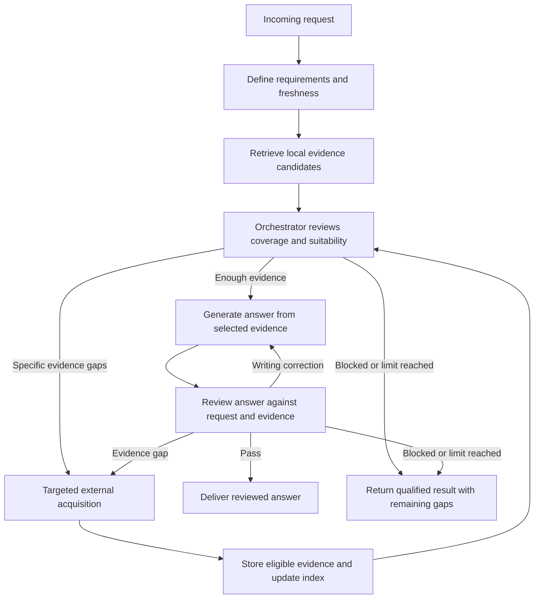
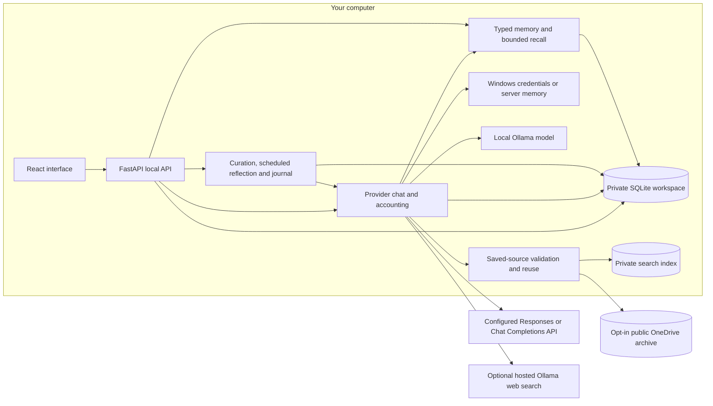

# Maestro architecture

Architectural direction updated 2026-10-16. Maestro is intended to be a personal AI coordinator that turns requests into bounded, reviewed work and maintains reusable evidence. The current research milestone is a factual search database: searches, their returned source material, original versions and decisions about using them. A later curated knowledge database is a separate capability. For research requests, inspect existing source records, establish what is missing or unsuitable, acquire evidence, and review an answer against the original request. Finance and local football are examples of domains using this shared workflow.

This overview defines the target direction and separates it from the implemented runtime below. The [chat design](CHAT_ORCHESTRATION.md) develops assessment, run status and later specialist execution; the [storage design](SEARCH_CONTEXT_STORAGE.md) develops capture, retrieval and archive integrity. The [development plan](../DEVELOPMENT_PLAN.md) tracks delivery and verification. This documentation update does not implement the target workflow or establish that a working-tree change is deployed.

## Target research workflow

The orchestrator owns the original request and its completion criteria throughout the run. Ordinary conversational requests can take a direct-answer route; necessary clarification precedes dependent research. The following branch applies when an answer requires evidence.

1. **Define requirements.** Record the subject/entity, requested facts, relevant dates or reporting periods, acceptable freshness, preferred or required source types, and expected output. Resolve material ambiguity before dependent work. For a stock request, identify the security and distinguish a quote from reported revenue, profit and announcements; record currency and units where applicable.
2. **Retrieve candidates locally.** Keep local retrieval separate from online acquisition. Inspect available evidence even when current information is required, so useful stable or historical material can be retained and exact gaps identified. Retrieval returns candidates with provenance, dates and completeness; a match alone does not establish adequacy. An unavailable or bounded lookup is recorded rather than described as an exhaustive miss.
3. **Assess each requirement.** The orchestrator records selected evidence, support locations, rejection reasons and gaps. Requirements may be covered, missing, stale for this request, conflicting or unavailable. Reuse valid evidence and supplement or refresh the affected parts. An old report may support a reporting-period fact while a quote needs a new observation.
4. **Acquire missing evidence.** A researcher chooses permitted searches or source connectors for explicit gaps. Record attempts and outcomes, obtain useful source content, and distinguish discovery, document retrieval and origin revalidation. Checking an old URL does not discover a newer report elsewhere; a latest-information request may require fresh discovery.
5. **Ingest before composition.** Save eligible acquired evidence and its acquisition metadata before generating the answer, then update derived indexes. A failed answer must not discard a successful capture. Capture failure or disabled saving is explicit; an otherwise permitted transient answer retains its available provenance and `not_saved` status. A requirement for durable evidence remains unmet if saving fails.
6. **Write from selected evidence.** Supply the writer with the request, requirements and relevant evidence passages or structured observations. Preserve source-version references and distinguish source facts, calculations and interpretation. Stored information outside the supplied evidence cannot be claimed as support for that answer.
7. **Review before delivery.** Check fulfillment of the original requirements, support for factual claims, dates, quantities, units, citations and contradictions. Bind claims about performed actions to backend outcomes. A writing problem returns to composition; an evidence problem returns to targeted research. Model agreement and a valid citation identifier alone do not establish support or truth.

Decisions and handoffs should use validated structured records, including requirement IDs, evidence references, reasons, gaps and the next permitted action. Application code enforces permissions, source integrity, budgets and state transitions. Model assessments supplement those checks. This is a target contract; exact schemas and API changes belong to implementation increments.

### Responsibilities and model roles

| Responsibility | Owns | Initial implementation direction |
| --- | --- | --- |
| Orchestrator | Request requirements, coverage decisions, next actions and final acceptance. | Explicit assessment and review stages with recorded decisions. |
| Evidence / DB service | Retrieval, validated ingestion, versioning, indexing, deduplication and provenance. | Deterministic application services; a model may propose extractions but does not freely mutate storage. |
| Researcher | Queries, source selection and acquisition for specific missing evidence. | Model-directed tools and configured source connectors within the run's permissions. |
| Answer writer | A coherent answer from the selected evidence and original requirements. | A separate composition stage with an explicit evidence packet. |
| Verifier | Requirement fulfillment, claim support, freshness and contradictions. | Initially an explicit orchestrator review phase; a separate reviewer model is optional. |

These are logical responsibilities, not a requirement for five models, independent conversations, processes or specialist child jobs. Start with sequential inference through the existing generation service. The same installed model can serve several roles with distinct instructions and selected context. Evaluate a different reviewer or specialist where it improves measured outcomes. The evidence workflow does not depend on implementing general task delegation first.

### Shared limits in code and agent instructions

The application owns one cumulative allowance for the whole research run, not a fresh allowance for each stage. Before each assessment, acquisition, writing, review or revision, it checks and reserves the remaining calls, tokens, time, estimated model spend and permitted hosted searches. Keep the initial one-hosted-search/run limit and the shared configured daily allowance of at most 20 during this rollout, honoring lower user settings. Reserve enough allowance to finish composition and review before optional further work. Foreground run ownership spans stage boundaries so another stage cannot accidentally start an independent budget or let background work take its reserved place.

Every necessary model stage receives a server-authored snapshot relevant to its assignment: the shared objective, completed/remaining work, total limits, cumulative consumed/reserved amounts, remaining allowance, deadline and available actions. Instructions tell the model to choose a useful next action within that allowance and report a gap when it cannot finish. Do not provide private keys, unrelated accounting history or unnecessary personal context. Application code recomputes authoritative balances at dispatch; a model cannot raise a limit, reset a counter, grant permissions or authorize a call by claiming that resources remain.

Keep actual token/call/search counts separate from money estimates. Model charges use the existing recorded pricing and usage; unknown hosted-search charges remain unknown and are not reported as free. Local model API charges do not estimate hardware or electricity. Extend the existing generation service with a narrow owned research-stage contract before the first typed stage, rather than impersonating a reflection job or adding another provider client. These are target requirements, not claims about the present per-call runtime.

### Completion, revision and runtime ownership

A fully satisfied result meets every mandatory criterion to its specified standard, including any qualification the request permits. An unavailable required item produces a terminal partial or inability-to-verify outcome, not full acceptance. Approval must refer to those criteria rather than an unrecorded judgment that the agent is satisfied. Conflicting evidence remains visible and may justify further research or a qualified result.

Every iteration must have a specific purpose: acquire evidence for a named gap or correct an identified answer defect. Enforce run-wide search, call, token, time and spend limits in application code and reserve allowance for final composition and review. Stop when the criteria are met, the user cancels, permitted resources are exhausted, a dependency is unavailable, or another round yields no useful progress. An unreviewed draft must not become an approved answer merely because the limit was reached; return a truthful partial or inability-to-verify result.

Persist the run's requirements, attempts, decisions, selected evidence, review outcome and actual stage transitions in private storage. Cancellation, reconnect and restart must not duplicate external acquisition or final answers, and stale attempts cannot commit. Uncertain external outcomes remain explicit. Extend the existing ownership and accounting contracts before introducing an independently dispatching worker; see the [chat runtime design](CHAT_ORCHESTRATION.md).

## Target factual search and source storage

Preserve the separation between private local databases and immutable source content. Keep canonical search, result, run and decision records in durable private tables, complete eligible acquired content in the archive, and derived keyword indexes in rebuildable local storage. "Factual" identifies source material to assess, not a claim that every source statement is proven true. A separate database per role or domain is unnecessary. The following are logical records, not a committed SQL schema. Source-linked observations and entity annotations can enrich the factual records later; an autonomous consolidated knowledge/memory database is outside the initial search rollout and must not block it. Existing private user memory remains a separate subsystem.

| Record | Essential information |
| --- | --- |
| Research run and requirement | Original request, subject, facts requested, relevant period, freshness/source criteria, coverage, decisions and final outcome. |
| Acquisition attempt | Query or requested resource, provider, relevant parameters, intent/requirement references, attempt time, status, returned references and failure or limit reason. |
| Source and source version | Stable source identity, exact observed locator/provider ID, publisher when known, content reference/hash, acquisition method, dates and completeness. Preserve observed URLs when normalizing identities. |
| Evidence item or observation | Supporting passage or structured value, subject, metric, units/currency, applicable time/period, source-version reference and support location. Retain extraction method/version for derived records. |
| Entity and relationship | Stable identity, type, aliases, topics and typed connections, with supporting evidence or an explicit inferred-association basis. |
| Answer and review provenance | Evidence actually supplied to the writer, claim/support references, calculations and inputs, review findings and backend action receipts. |
| Derived index | Searchable text and later measured retrieval enhancements, rebuildable from canonical records and source versions. |

Document identity, content identity and acquisition identity are distinct. Identical bytes can share one content object while recurring acquisitions preserve their own timestamps and provenance. Changed content creates a new saved version. A new version does not rewrite an earlier answer's evidence. Canonical search links, annotations and review decisions must survive an index rebuild. Generated answers and summaries are derived artifacts linked to evidence; they do not become independent primary evidence by being stored.

### Proposed OneDrive archive and local working files

Use a fresh proposed source-file root at `C:\Users\malme\OneDrive\Maestro-SearchArchive`. The earlier scaffold/archive can be ignored by the revised implementation; no automatic import, move or deletion is implied. This path is a proposal for implementation, not an already-created folder or a runtime configuration change. Keep the private live SQLite databases, search/query mappings, run/accounting records and derived indexes in the configured local Maestro data directory outside OneDrive and Git. The index may consume additional local space beyond the archived files.

OneDrive is cloud-backed synced storage, not additional local disk or model memory. Files created on the PC initially consume local disk; reading an online-only file downloads it. Files On-Demand can later release local file contents while retaining cloud files, whereas "Always keep on this device" retains a local copy. Newly acquired files therefore still require free local staging space, and cloud quota does not remove local disk constraints. Keep archive lookup bounded so a metadata listing cannot accidentally download the collection. See [Microsoft Files On-Demand](https://support.microsoft.com/en-us/onedrive/save-disk-space-with-onedrive-files-on-demand-for-windows).

Expose separately the archive's logical bytes, actual locally allocated bytes when measurable without hydration, local index/staging usage, free local disk and known sync/availability state. Cloud quota and cloud upload completion require their own verified observations; a configured allowance or filename is not evidence of either. The user's estimated cloud capacity is not a verified quota and should not become a hardcoded allocation. Exact archival/local-cache allowances can be chosen from observed capacity during implementation. Compression and automatic local-cache management are later optimizations.

### Content acquisition and model context

Store as much complete useful acquired evidence as reasonably permitted by eligibility, free space and configured acquisition/archive limits. Warn about unusually large payloads rather than imposing an arbitrary tiny excerpt limit on storage. Retain finite configurable hard protections for extreme response/document sizes, decoded/extracted growth, processing time and minimum local free space; warnings alone cannot prevent an out-of-memory or full-disk failure. Refusals, partial captures and known truncation must be explicit. These source-file protections are independent of the model's input allowance.

Keep complete eligible provider content independently of the smaller passages selected for a model. Record whether content is a search excerpt, provider-extracted page, original document or structured API response; record known truncation and extraction limitations. A search snippet is a discovery lead and may support only the limited claims it actually contains. The archive does not need semantic indexing, model-generated compression or file compression to become useful.

The local integration working tree already archives complete sanitized search extracts before fitting model evidence to at most 1,200 characters per source; not all of this is merged on main. That prefix limit describes what the model receives, not the intended archive capacity. Replace it in the revised path with bounded requirement-relevant passages selected anywhere in the saved text. Preserve validated source offsets, capture/content hashes and passage hashes, and use the same selected packet for coverage, writing and review. Preserve legacy prefix-based follow-ups while their callers migrate. A fixture must find and reuse support beyond character 1,200 without a hosted search. Increasing storage, result count or context alone does not turn snippets into complete original documents. Ollama exposes separate search and page-fetch capabilities; its fetch response contains main page content rather than an original-byte archival contract. See [Ollama web search and fetch](https://docs.ollama.com/capabilities/web-search).

Preserve original response/document bytes when an acquisition method actually provides them, extracted readable content separately, and extraction versions so derived material can be regenerated. Full-page/PDF acquisition needs the transport and parser boundaries in the [storage design](SEARCH_CONTEXT_STORAGE.md#full-source-downloads). Never relabel an older excerpt as a full document or regenerate missing historical bytes from a current page.

### Freshness and historical value

Treat `stale_after` as a best-before date: evidence may need checking before it supports a current-information answer, but remains stored and can still support historical questions. Freshness is suitability for a particular requirement, independent of retention. Use information-type and domain policies rather than one universal reuse window. Set actual durations later; the minimum early policy preserves known dates/periods and treats unsupported currentness as a gap.

| Field | Meaning |
| --- | --- |
| `retrieved_at` | When Maestro acquired the observation; local reuse does not reset it. |
| `published_at` / `modified_at` | Source-reported dates when known, with their basis and precision; unknown dates remain unknown. |
| `as_of` / reporting period | When a claim or structured value applies. Different observations in one document may have different periods. |
| `last_verified_at` | When a particular source representation or observation was checked again, with method and outcome. Revalidation does not independently prove factual truth. |
| `stale_after` | A policy-derived threshold for requiring refresh for a specified use, with the relevant policy/version or requirement context. |

Fetching an old article today does not make its contents current. A past financial report can remain useful for a historical request after becoming unsuitable for the latest-results requirement. Quotes, reporting-period figures, future fixtures and completed match results need different policies. Explicit source modes, fresh-search instructions and no-search instructions remain enforced; inspecting saved metadata must not silently replace a required fresh acquisition or authorize a forbidden one.

Repeated checks and newer observations can mark an earlier record stale, superseded, obsolete or disputed, with the reason and supporting version retained. Preserve the old bytes and their dates rather than overwrite them. Derived publication/validity assessments belong in private records referencing immutable captures, or a deliberately versioned new format with backward readers; do not rewrite old manifests pinned by earlier answers. Eviction is a separate future process that may consider very overdue stale dates, confirmed obsolescence, space pressure and dependencies. A stale date, new contradictory result or code refactor does not by itself authorize physical deletion. No automatic eviction is part of the first rollout.

### Three separate cleanup decisions

| Kind | What changes | When and why |
| --- | --- | --- |
| Program-code retirement | Remove unused old routing, prompts, adapters and duplicate UI after replacements and callers pass checks. | During each replacement PR and a final removal-only gate, to keep one maintained implementation. Does not delete saved source or memory records. |
| Local-copy release | OneDrive releases downloaded contents while retaining the cloud file. | A separate future local-cache policy or user action after sync/availability checks, to recover local disk. This is not archive deletion. |
| Archive eviction | Remove retained source versions/content according to reference-aware retention rules. | A later explicitly configured process; may consider very overdue best-before dates or demonstrated obsolescence. Keep reasons/history and protected references. No automatic source-file deletion now. |

### Reuse and unnecessary-search prevention

Separate evidence reuse from acquisition deduplication. Evidence reuse asks whether existing observations satisfy a requirement. Acquisition deduplication asks whether an equivalent permitted search or fetch was recently completed or is already in progress.

Compare entity identity, requested metrics, relevant period, freshness requirement, provider and material parameters. Query text alone misses equivalent requests; semantic similarity alone can incorrectly merge different securities, currencies or periods. Record recent and in-progress attempts and their outcomes, and share acquisition results only when each request's criteria and privacy scope permit it. A failed or empty search must not suppress needed research indefinitely. Preserve source timestamps when reusing results.

### Domains, table view and graph view

Finance, football and future domains initially share this evidence model and run pipeline. Configure their preferred sources/connectors, terminology, freshness rules, extraction schemas and review criteria. Introduce separate specialist agents when their work requires a distinct capability or materially different workflow; avoid isolated databases that prevent shared entities and evidence from connecting.

Provide two views over the same canonical records:

- **Table:** inspect source/version to stored content and extracted observations, linked searches, relevant dates, completeness, freshness for a selected use, and answer usage. Support filtering and opening the exact saved version.
- **Graph:** first explore recorded request -> search/acquisition -> exact source-version links. Later add source-backed entity/topic annotations and observations, such as company -> issued -> financial report or club -> participates in -> competition, when those records exist. That later enrichment is not a prerequisite for the factual search store or its first graph.

Selecting a node or edge should expose its source/version, supporting passage or derivation, relevant dates and review status. Visually distinguish sourced relationships from inferred topic associations. An associative edge is useful navigation, not factual evidence by itself. The existing private-memory map remains a separate view and does not already implement this research graph.

A graph UI can use ordinary entity and edge tables in SQLite; adopting a graph database is not an initial requirement. Retain the current keyword index, and add semantic retrieval or graph infrastructure only when measured retrieval misses, traversal needs or scale justify them.

### Frontend composition and visible increments

Follow the composition used by the Argus Stock page: a small page entry arranges domain sections, cohesive hooks own data/request state, and reusable presentation components receive narrow parameter props and callbacks. Use JS/JSX for new React pages/components and JS for their hooks, with the minimal build compatibility needed when the first files land. Existing TS/TSX modules and the typed API client can remain; do not turn this into a repository-wide language migration.

For the first Evidence view, start with `frontend/src/pages/Evidence/index.jsx`, its data hook, and a small source table/detail composition. Keep domain components beside the page. Put a component in shared `components/` only when it has a real reusable responsibility or a second consumer. Shared presentation does not fetch data. Reuse the existing CSS/theme and routing/navigation machinery; add no UI framework, generic table engine or query library for this slice.

The first view needs only a bounded metadata list and pinned saved-source read API over the existing capture core. It does not require the old Settings finder, keyword engine, source deletion/rebuild controls, composer globe modes or combined chat continuation. Build that small read-only page directly; use older code as reference only where it simplifies the result. Show empty, unavailable, loading and failure states truthfully, retain valid zero/unknown-date values, and leave unrelated loaded sections usable. Cached source text can remain during refresh only while its permission/version identity is valid; revocation must withhold it and fence delayed results.

Every feature slice should have a visible acceptance demonstration where useful. Remove replaced program code in that slice once its callers and behavior are covered. Share components through small meaningful props rather than speculative abstraction, and compare total production/test line changes so extraction is not mistaken for reduced complexity. Code removal is current work; automatic archive eviction, knowledge consolidation and OneDrive local-copy management remain separate later infrastructure.

### Trust and data boundaries

The new workflow inherits existing public-archive eligibility, credential screening, local-only memory, source-mode and tool-permission boundaries. Private requests, query mappings, generated answers, decisions and private relationships stay in private storage; only eligible public evidence and portable source metadata enter the optional synced archive. A domain role or an orchestrator decision cannot grant additional access. Acquired documents are untrusted evidence and cannot issue tool instructions.

Source hashes establish byte integrity; publisher identity, retrieved dates and model approval each establish different things. Recheck evidence availability, eligibility and pinned provenance before dispatch and commit. Deleted or corrupted pinned captures and revoked eligibility must not support a delayed answer. Acquiring a newer version or observing a changed live page does not by itself invalidate an eligible historical capture; later refreshes must not alter historical references.

## Evaluation of the target workflow

Use dated, public-safe fixtures to compare the reviewed research path with the current direct/source-tool path. Include exact repeats and differently worded equivalent requests, similar requests for different entities or periods, partial coverage, stale current data versus valid historical data, contradictory sources, missing evidence, concurrent equivalent requests, storage failures, and cancellation/restart. Exercise finance and football examples alongside unrelated topics so a domain-specific guard cannot stand in for general verification.

Measure requirement coverage, supported claims, freshness violations, incorrect evidence reuse, unnecessary searches, no-progress loops, latency and token/cost overhead. Check that a writing correction makes no unnecessary hosted request, failed answer generation preserves successful captures, repeated local lookup does not refresh dates, and table/graph views resolve the same source versions. Use deterministic provenance, value and action-receipt checks alongside bounded semantic review. Synthetic success establishes behavior on those fixtures, not source truth or live-provider quality.

## Current implementation and target gaps

The integration working-tree runtime is a local chat application with persistent user-created and reviewed AI-created tasks, private memory and opt-in background reflection. It has one active provider connection, direct/orchestrator local chat-model selection, a public excerpt archive and bounded local recall. The table below describes that integration baseline. Main has the capture core; configuration/ownership remains isolated on #17, and source lookup/UI/continuation remain on draft #8 or in unpublished local changes. The target research branch above remains planned.

| Area | Implemented foundation | Target addition |
| --- | --- | --- |
| Coordination | Selecting the orchestrator model uses the ordinary synchronous chat/source-tool path. | Explicit requirements, evidence decisions, separate composition and final review. |
| Retrieval and acquisition | Exact/keyword reuse for eligible stable requests; current/unspecified freshness requests bypass saved candidates. | Separate local candidate retrieval from external acquisition and assess candidates per requirement, including current-information requests. |
| Storage | Immutable excerpt captures, content deduplication, private mappings, rebuildable FTS, hash-bound citations and capture before synthesis. | Durable research attempts/decisions, evidence observations, entities and supported relationships. |
| Freshness and verification | Global retrieval-age reuse window, limited date-specific weather guards and provenance checks; publisher dates remain unknown. | Information-specific freshness, reporting-period semantics, claim support and request-fulfillment review across domains. |
| Inspection | Saved-source finder/viewer and a separate private-memory map. | A research evidence table and graph over shared canonical records. |
| Execution | One generation slot, shared accounting and existing reflection jobs. | Observable research runs and ownership-aware recovery; general task execution and specialist delegation remain later work. |

The following sections describe the integration working-tree runtime, not everything merged on main. Main has the capture core; configuration/ownership is isolated on #17, and other source integration/local changes remain on draft #8 or unpublished. They should not be read as claiming that the target review loop, research graph or general delegation already works.

## Implemented boundaries

The built frontend is served by FastAPI on one loopback origin. Workspace contains chat, Tasks contains attributed to-dos, and Memory contains the map/list, source evidence, proposals and reflection journal. Settings configures models, credentials, search, reflection and limits, with links to Memory and usage. The header and usage view report actual model usage and estimated spend.

`backend/app.py` owns session/CSRF protection, validation, CRUD and the application lifespan. `backend/provider.py` owns the single connection, shared generation slot and usage ledger. `backend/reflection.py` owns durable idle jobs, source validation, two-stage curation, scheduled working notes and a private journal. `backend/work_config.py` validates private task models and worker policy; `backend/memory.py` owns accepted records and read-only recall. `backend/web_search.py` owns hosted search readiness and limits. `backend/context_store.py` owns public capture eligibility, immutable objects/manifests, private query mappings/indexing and independent archive ownership; `backend/context_tools.py` defines freshness decisions. Reads avoid writes after initialization. SQLite writes use immediate transactions; generation runs outside locks. One worker runs inside the sole API process under exclusive workspace ownership.

Ollama uses its native loopback API, accepts installed local models and has no cloud fallback. Other adapters use Responses or Chat Completions. The UI always uses the chat role. Saved `chat_routing` selects the direct chat default or configured orchestrator model for local chat; a blank orchestrator selection uses the chat model and an explicit per-message choice wins. Existing connections default to direct routing. Coordinator instructions use the existing source-tool path, without another assessment call or specialist dispatch. Chat sends the selected conversation and optional local memory; the frontend progressively reveals the completed backend reply and renders safe Markdown. Reflection receives explicitly selected bounded evidence/memory, without implicit recall, tools, hosted search or conversation titles. Chat curation forms then reviews facts/preferences; scheduled reflection forms then reviews identity/lesson notes. Both use one shared slot and at most two calls.

Chats have stable IDs, separate message lists and editable titles. Workspace responses include chat summaries, `active_chat_id` and the selected chat's messages; generation captures an explicit chat ID. New chat preserves existing conversations. Deletion removes a chat's content while retaining the shared usage ledger, and is blocked while that chat has a reserved request. Previous live history migrates once into one conversation. Projects remain a later feature.

Manual task creation, completion/reopening, suggested-assignee changes and deletion only update local records. The server assigns immutable `initiated_by` (`user` or `maestro`); `suggested_assignee` uses the same values and remains editable. Older records expose `user` defaults without rewriting storage on reads.

Periodic reflection receives a server-authored capability overview and improvement goals alongside current practices and optional exchanges. `backend/capabilities.py` shares declared capabilities with the workspace API. It may propose useful practices or experiments without chat evidence; prompts distinguish untested ideas from observed outcomes. The journal records this assessment basis without inventing source messages or feeding journal prose back as evidence.

With `auto_create_tasks` enabled, periodic reflection may propose at most two follow-up or self-improvement tasks in its existing formation call, and the independent reviewer approves task indices in its existing second call. Approved tasks enter the same list in the final checked transaction; no extra model call or approval queue is added. Existing open/completed titles and bounded hashes of deleted AI titles suppress repeats. A suggested assignee is a label, not a dispatch instruction. There are no tools for task execution, repository changes, integration access or agent handoffs.

## Generation and usage

1. Read the active model configuration and the requested chat's context.
2. Check context/output token limits and configured spend allowances. Reserve conservative estimated usage in an immediate transaction.
3. Dispatch one generation, or the bounded Ollama search flow described below. The reservation permits one request at a time across chat and explicit-context calls.
4. Persist the reply and settle provider-reported token usage with the configured price snapshot. After a chat's first successful exchange, optionally generate its title once with the original model and remaining request allowance. The title call uses a bounded first message and no tools, and is skipped if model settings change. Failure keeps the first-message fallback and the successful reply; a manual rename wins over a delayed generated title. Unknown paid title usage still requires reconciliation.
5. Keep unresolved paid usage reserved until the user verifies and reconciles its amount. Known access/quota rejections and confirmed local failures release their reservations. Local chat, titles, and background calls with unknown completion retain a zero-cost slot. Only an explicit acknowledgement that the original Ollama server was restarted, followed by an empty model check on that original endpoint, releases the interrupted request. Loading and queued work can be absent from the model list, so it cannot acknowledge termination automatically. Recovery rechecks request ownership and endpoint under the ledger lock and never releases an active foreground call or reflection phase.

Local model API charges are zero; hardware and electricity costs are outside this accounting. Remote charges are estimates from saved prices, not invoices. Earlier entries keep their recorded prices. An API restart marks interrupted paid requests uncertain. This startup recovery assumes there is no independent live worker and must change before cross-process dispatch is enabled.

## Optional search

When automatic search is explicitly enabled and a separate search key has been tested, a tool-capable local Ollama model may request `web_search` within the configured message allowance. With the archive enabled, `search_context` replaces that tool and first checks eligible saved evidence according to the request's freshness mode. A cache miss requires the existing hosted readiness, privacy and quota checks. Recognized dated local-weather requests require source evidence even in default mode; unavailable fresh setup fails before inference and unsupported direct replies cannot commit. Raw and fitted weather excerpts must contain the requested full dates; if none qualify, the server records an inability-to-verify reply with source metadata and actual first-call usage. Date presence is not factual validation. Hosted requests use only `https://ollama.com/api/web_search`; eligible bounded, untrusted excerpts support follow-up source requests and final local synthesis. Tools are removed when research must stop. Query and source provenance persist beside the answer.

Settings allow one to five source lookups per message, defaulting to five. Sequential model calls share the output allowance and cumulative token check; known usage remains accounted if acquisition or a model response fails. At the message cap, final synthesis uses collected evidence and discloses the research restriction. Saved-source lookup consumes the message allowance without charging the hosted-search daily cap. Search tests and interrupted/failed hosted attempts count toward the daily cap. One in-flight search, five-second spacing, a 30-second timeout, response-size limits and provider cooldowns apply. Follow-up hosted searches wait for the existing spacing allowance; failed attempts are not automatically retried. A one-time title call may use the remaining request allowance. Result pages are not fetched. Hosted search fees are unknown and excluded from local inference's zero API cost.

This is a bounded tool call inside chat. It does not delegate a task or create an autonomous agent.

The opt-in [search context archive](SEARCH_CONTEXT_STORAGE.md) saves eligible public excerpts in immutable files with portable metadata and keeps a rebuildable full-text index in private local storage. New configurations default to disabled `all_public` capture with adjustable 10 GiB/200,000 file-and-directory limits; existing approved-URL policy and limits persist. Broad capture accepts eligible public HTTP/HTTPS snippets without origin fetching, with credential/private/authenticated URL exclusions. Restricted HTTPS scopes remain available. Repeated acquisitions create new capture records and deduplicate objects; status exposes measured usage and last-capture sizes. Fixed public connection tests always go online and save eligible results only with enabled broad capture.

The local `search_context` tool tries exact-query reuse then keyword retrieval independently of hosted readiness, with server-enforced saved-only/refresh modes and original dates. Optional exact-domain and inclusive UTC retrieval-date filters restrict lookup to saved evidence and prohibit hosted fallback. Bounded local follow-ups reconstruct source status and fitted evidence from server-held provenance; old source bodies are not used to plan fresh/current requests or sent to hosted search. Content/manifest hashes bind historical citations; source validation guards final dispatch and answer persistence while consumed usage remains recorded. Generated JSON cannot write archive files. The Settings archive controls, local source finder and authenticated source viewer use the existing session/CSRF boundary. Publisher dates, full page/PDF downloads and automatic pruning remain later increments.

## Private state and credentials

Tasks, live messages, typed memories, reflection journals, limits, settings and ledgers live in SQLite outside the checkout. The default directory is `%LOCALAPPDATA%\Maestro\preview`; `MAESTRO_DATA_DIR` must also resolve outside the repository. Provider/search credentials live in Windows Credential Manager, server memory or mounted secret files. The OpenAI endpoint can use a server-environment key fallback. Read APIs expose credential presence, never values.

The separate `MAESTRO_CONTEXT_ARCHIVE_DIR` exports only eligible public source excerpts and portable metadata under the enabled capture policy. Queries and capture references stay in the workspace database; the disposable index lives alongside it at `context/index.sqlite3`. Neither private workspace data nor a live SQLite file belongs in the synced archive. Container setup uses the explicit `-ContextArchivePath` mount option.

The API validates Host and Origin, requires a local session and protects mutations with CSRF checks. Remote provider requests send the selected conversation history to that provider; Ollama sends it to the local server. OpenAI requests set `store: false`. The repository and synthetic test fixtures contain no private workspace records or personal credentials.

Earlier prototype-only records remain archived in the private database, and old reflection tables remain inactive. Simulated messages are excluded from active chat and provider context. Private memory uses a separate table with typed origin/provenance metadata, save/edit/pin/forget and bounded local recall. Optional automatic curation protects human edits and records changes in a private journal. Memory-derived conversations cannot later dispatch to remote providers or active hosted search. The [memory/reflection design](MEMORY_AND_REFLECTION.md) documents formation/review, persistent schedules, correction and deletion boundaries.

The memory map is a frontend view of those records: type groups, bounded selectable nodes, search/scope filters and existing source references. It shares editing and forgetting with the list view and requires neither another database nor model inference. Recorded source dependencies describe how a memory was derived; they do not establish semantic similarity.

## API surface

| Routes | Purpose |
| --- | --- |
| `GET /health`, `GET /api/session` | Local health and session/CSRF setup. |
| `GET /api/workspace?chat_id={id}` | Chat summaries, selected messages, tasks, limits, shared usage and capability status; selection is optional. |
| `POST /api/chats`, `PATCH /api/chats/{id}`, `DELETE /api/chats/{id}` | Create, rename or delete a conversation, retaining accounting. |
| `POST /api/tasks`, `PATCH /api/tasks/{id}`, `DELETE /api/tasks/{id}` | Create a user-initiated task; change completion/suggested assignee or delete it. Initiator is server-owned. |
| `POST /api/chat` | Generate a reply for the submitted `chat_id` and persist it in that conversation. |
| `PATCH /api/chats/{chat_id}/messages/{message_id}/feedback` | Save/edit/clear an optional rating and comment on an existing answer, without inference. |
| `GET /api/memory`, `POST /api/memory`, `PATCH /api/memory/{id}`, `DELETE /api/memory/{id}` | Inspect, save, edit/pin or forget private memory; snapshots also include records. |
| `GET /api/work-config`, `PUT /api/work-config` | Saved task models, recall allowances and reflection enable/pause policy. |
| `GET /api/reflection` | Read-only worker status, daily usage, current memories, journal and legacy proposals. |
| `POST /api/reflection/candidates/{id}/accept`, `DELETE /api/reflection/candidates/{id}` | Accept a source-backed proposal into scoped private memory or reject it. |
| `GET /api/provider`, `PUT /api/provider`, `POST /api/provider/test`, `DELETE /api/provider/key` | Active connection settings including local chat routing, model-list access and credential removal. |
| `POST /api/provider/charges/{id}/reconcile` | Settle a provider-verified uncertain amount. |
| `GET /api/web-search`, `PUT /api/web-search`, `POST /api/web-search/test`, `DELETE /api/web-search/key` | Search readiness, settings and separate credential lifecycle. |
| `GET /api/context`, `PUT /api/context`, `POST /api/context/rebuild` | Archive readiness, capture policy/scopes, measured usage and last-capture sizes, reuse/storage limits and bounded index reconstruction. |
| `POST /api/context/search` | Read-only keyword lookup with exact-domain, UTC retrieval-date and historical-source controls. Private terms stay out of request URLs; no model/search calls or query-map writes. |
| `GET /api/context/sources/{id}`, `DELETE /api/context/sources/{id}` | Inspect a saved excerpt with optional historical content/manifest hashes, or publish its deletion marker. |
| `PUT /api/limits` | Save the enforced chat spend/token allowances. |

## Next build sequence

The [Podman deployment checklist](../DEVELOPMENT_PLAN.md#podman-deployment) runs alongside this functional sequence. The [container runbook](CONTAINERS.md) covers one application container, persistent private storage and host Ollama. Native and container runtimes acquire an exclusive workspace lock before recovery; keep one API owner per workspace until worker ownership and leases are implemented. Local chat and planning roles can choose distinct models through the same reservation ledger; named endpoint profiles and task routing remain separate work.

The shared generation foundation is implemented: `Provider.generate_context` accepts bounded selected context and an installed local model through the same ledger as chat, without tools, titles or chat persistence.

First publish the clarified overview/map the narrow draft prerequisites ([#19](https://github.com/erikmalm/maestro/issues/19)) and restore the known synthetic baseline ([#35](https://github.com/erikmalm/maestro/issues/35)). Configure the revised source archive ([#36](https://github.com/erikmalm/maestro/issues/36)); use the fresh root without automatic migration of the old scaffold. Add the Evidence table and factual completed-request receipts, alongside separating local candidates from acquisition. These are useful first increments even when the new archive initially contains no sources.

Then implement the [target research workflow](#target-research-workflow): owned observable runs, the shared model-stage/allowance contract before any typed stage ([#37](https://github.com/erikmalm/maestro/issues/37)), explicit requirements, relevant saved passages, recorded evidence decisions, writer composition and final review. Code and necessary agent instructions share the cumulative limits. Add live stages only as the backend records them. Journal acquisition attempts before targeted hosted search, initially at most one/run within the current 20/day allowance or a lower user limit. Routine development and local-model quality trials replay fixed sources without hosted searches.

Keep minimum date/best-before decisions in the initial evidence assessment, extending policies later. The first graph can show recorded request/search/source-version links without a knowledge database; richer entity annotations can follow independently. Selected full-page/PDF capture extends the same evidence contract after grounding is established. General specialist execution is not a prerequisite. [Tracker #18](https://github.com/erikmalm/maestro/issues/18) links the increments and separates core delivery from later enrichment. Validate routing/caller migration first ([#38](https://github.com/erikmalm/maestro/issues/38)), then remove remaining superseded code in a separate removal-only gate ([#31](https://github.com/erikmalm/maestro/issues/31)). This does not delete private-memory data or source content. Physical source eviction, compression and automatic OneDrive local-copy release are later policies.

The [development plan](../DEVELOPMENT_PLAN.md#next-delivery-sequence) owns delivery and acceptance. [CHAT-01 and CHAT-02](CHAT_ORCHESTRATION.md#implementation-increments) supply status and assessment foundations; the research branch adds the evidence decisions and final-review stages described here. CHAT-03 and CHAT-04 remain later specialist increments. Bind source claims to evidence and action claims to backend outcomes before broader acquisition or delegation; model agreement alone is not verification. Exact schemas, thresholds, migrations and graph technology are implementation decisions to validate against this overview.

Task execution requires durable claims, leases and ownership-aware recovery: API restart must not release a live worker's reservation, and stale attempts cannot commit after a newer claim. Descendants share the parent's bounded context, tools and call/token/time/spend allowance, with cancellation and no-progress stops. A first local specialist can reuse saved model choices once attempt ownership works; named profiles broaden routing afterward. Explicit memory and [durable background reflection](MEMORY_AND_REFLECTION.md) are already usable independently; automatic promotion, scheduled notes and reviewed task suggestions are optional, with broader quality evaluation still needed. Scoped integrations and isolated coding require the execution path. [Local model research](LOCAL_MODELS.md) records preliminary measurements.
