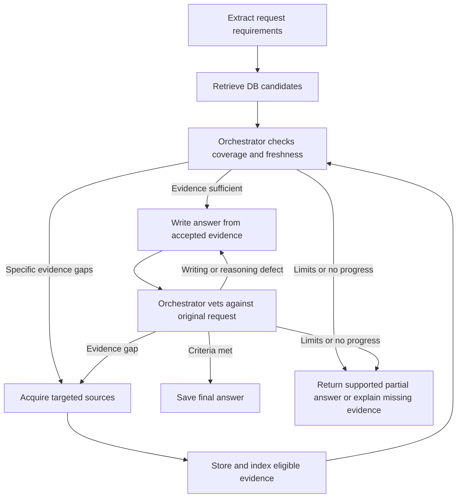
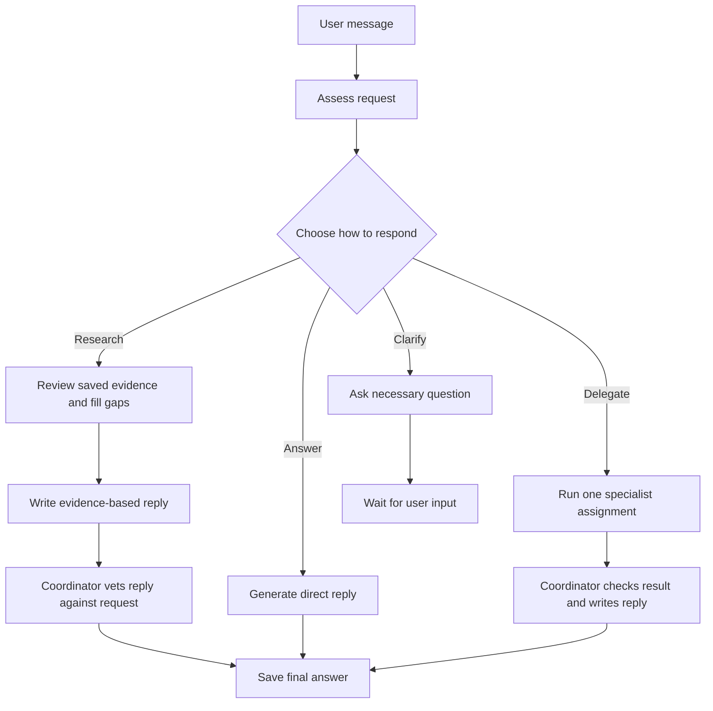

# Chat assessment and delegation

Design agreed 2026-10-16; checkpoint 2026-10-23. Main `739d27a` includes local coordinator selection, hosted continuation, Evidence/candidates (#22), durable runs (#23), owned stages/shared budgets (#37), and validated requirements/clarification (#24/PR #48). This branch adds explicit saved-evidence coverage (#25). Writing/final vetting (#26/#27), automatic chat routing and specialist execution remain proposed. See the [evidence contract](ARCHITECTURE.md#saved-evidence-review-25).

Each user message should first reach a coordinator that assesses the request and chooses how to handle it. The coordinator can answer directly, ask a necessary clarification, follow the research workflow, or assign a bounded task to an available specialist. The user sees useful progress as work happens and receives one coherent answer in the original conversation. The [target research workflow](ARCHITECTURE.md#target-research-workflow) is the architectural overview; this document describes its place in chat routing and the existing specialist design.

The first implementation should use local Ollama, one specialist at most when delegation is needed, and sequential inference. Research stages do not themselves require specialist child jobs. Reuse Maestro's generation and accounting service, private storage, and saved model choices. Add the workflow in small increments without an agent framework or a growing tree of workers.

## Current behavior

Implementation baseline: merged #24 passed 631 backend tests; the unchanged frontend had full 99-test/build verification plus later focused Research checks. New Research submissions in this branch use `evidence_review`: one local requirements call, then bounded local candidates and an optional second call assessing selected saved passages. Clarification stops after one call. Disabled/empty storage or passages that cannot fit record gaps without the second call. Results remain partial/no-answer and show per-item covered/missing/stale/conflicting/unavailable decisions, reasons and exact source support. Requirements receive no history, recall or archive content; evidence review adds only the recorded requirements and selected saved public passages. Neither performs hosted acquisition, writing or final review. Historical lookup and requirements-only clients remain compatible under #31; ordinary chat below is unchanged.

The chat UI submits `role: chat` to `POST /api/chat`, which waits for `Provider.chat` to finish. Local **Chat routing** chooses the normal chat model or configured installed orchestrator model, with chat-model fallback for a blank orchestrator choice. An explicit per-message model overrides that route. Existing configurations default to `direct`; `orchestrator` applies to local Ollama only. The reply and ledger record the actual selected model.

The selected model receives conversation context and optional private memory, chooses whether to request the hosted search tool and writes the answer. Main permits one hosted-search round and at most two answer-model calls with shared accounting. It does not yet query saved evidence or automatically capture those results. Model selection adds no separate typed assessment or worker handoff. The browser reveals the completed reply progressively; provider streaming and durable semantic stage events remain planned. Evidence independently browses the saved-source catalogue, updates automatically and revalidates pinned text without model or hosted-search calls.

Background reflection has its own fixed formation and review workflow. It can create attributed to-dos, but those records do not execute. The coordinator route is a synchronous chat option; general delegation is unavailable. See the [architecture](ARCHITECTURE.md) and [development plan](../DEVELOPMENT_PLAN.md).

## Target research branch

The complete research branch remains a target beyond this increment. This branch implements local per-item evidence decisions after the merged requirements stage, with no source acquisition, answer writer or final vetting. Byte/manifest integrity and current-credential checks establish source identity, while model relevance and source/qualifier judgments remain semantic assessments. Older draft #8 cache modes and replay are not prerequisites to import.

The target sequence is request requirements, DB candidates, orchestrator coverage and freshness review, targeted acquisition with ingestion, answer writing, and final vetting. The orchestrator retains the original request and its acceptance criteria through every phase.

| Responsibility | Contract |
| --- | --- |
| Orchestrator | Defines requested items and freshness needs, accepts or rejects candidate evidence with reasons, requests specific missing research, and vets the answer against the original request. |
| Evidence service / DB manager | Deterministically retrieves candidates and provenance, validates storage eligibility and integrity, persists captures, and maintains indexes. It reports matches and metadata; it does not declare the user's question answered. |
| Researcher / acquisition | Acquires evidence for an explicit gap through available, permitted connectors. It returns source material and acquisition metadata rather than an unsupported conclusion. |
| Answer writer | Produces the requested answer from the accepted evidence, preserving citations, observation dates, currencies, units and stated uncertainty. |
| Verifier | Checks coverage, claim support, freshness and consistency. Initially this is an explicit orchestrator phase; a separate reviewer can be introduced if evaluations justify it. |

These are logical responsibilities, not a requirement for five agents, different models, parallel inference or durable specialist children. A single local model can perform separate orchestrator and writer calls while ordinary services perform DB operations and connector acquisition. Acquisition has only its assigned source scope and allowance; it cannot expand permissions or launch arbitrary actions. Domain-specific research, such as finance or football, can later supply appropriate connectors and evidence policies through the same contracts.

Always retrieve relevant DB candidates before deciding what new research is needed, including for current-information requests. A match is a candidate, not an acceptance decision. Review coverage of each requested item, the date or period the fact describes, source quality and the required freshness. A recent search timestamp alone does not make its facts current. Older evidence can support historical context while current claims require new evidence; retain it instead of treating staleness as deletion. The orchestrator must be able to reject a matching result and request fresh discovery, rather than receiving an automatic saved answer or being forced to repeat an undifferentiated search.

Acquire only for identified gaps, then store and index eligible results before the next evidence review or synthesis. Preserve full bounded provider text separately from the smaller model evidence packet, and retain source versions and the exact excerpts used in the answer. This does not turn provider excerpts into full origin documents. Search, download, archive and model-context limits remain separate; saving failures must be reported and follow the existing permitted transient-evidence behavior rather than inventing a saved capture.

Final vetting checks explicit criteria: requested items are covered or identified as missing; factual claims have supporting evidence; dates and freshness meet the request; values, currencies and units agree with sources; and contradictions or uncertainty are disclosed. A writing or reasoning defect returns to the writer using the same evidence. An evidence gap returns to targeted acquisition and ingestion. Model agreement or an unqualified statement that the orchestrator is satisfied is not an acceptance test.

Both revision paths are bounded by the same run-wide call, token, time, estimated spend and source allowances. The server enforces the cumulative allowances described below; each model stage receives the same current remaining allowance in its instructions. Stop when criteria are met, a limit is reached, cancellation occurs, acquisition is unavailable, or another iteration cannot add evidence or fix a specified defect. Record gap and rejection reasons plus completed searches so a repeated equivalent search is reused or suppressed unless a freshness or coverage change justifies it. Preserve a supported partial answer and explain unresolved items when completion is impossible. Research stages never expand source access: saved-only mode, explicit no-network instructions, private-memory restrictions, capture policy, deletion barriers and current tool readiness remain enforceable server rules.

## Proposed user experience

Submitting a message starts a run attached to that message. A compact status area appears beneath it and updates when the server records a change. The final answer takes its usual place in the conversation; completed progress can be expanded afterward.

An ordinary question might show “Considering your request” followed by “Writing a reply.” A comparison that benefits from a specialist might show “Considering your request,” “Asking the analysis specialist to compare these options,” and “Checking the comparison and writing a reply.” These transitions appear only when their corresponding work starts.

| Status | When it appears |
| --- | --- |
| Waiting for the local model | The run is queued behind another inference call. |
| Loading the selected model | The runtime begins loading or switching models, when that operation can be observed. |
| Considering your request | The coordinator's assessment call starts. |
| Checking saved sources | The evidence service starts retrieving DB candidates. |
| Reviewing source coverage and freshness | The orchestrator starts checking candidates against the request. |
| Asking the analysis specialist to compare these options | A validated specialist assignment starts; the wording identifies the actual assignment. |
| Searching the web | An enabled search tool is actually dispatched. |
| Checking the result and writing a reply | The coordinator starts the combined check-and-reply call on a saved specialist result. |
| Writing a reply | Final answer generation starts. |
| Checking the reply against your request | Final research-answer vetting starts. |
| Waiting for your reply | A clarification question has been saved. |
| Stopped or interrupted | The run ends or pauses with a concrete reason and any useful saved progress. |

Use concise stage descriptions and brief task summaries. Keep internal reasoning private. Do not reveal hidden deliberation, raw prompts, or invented agent conversations. An assignment summary can be based on validated structured output; authoritative stage changes come from the runtime. Show elapsed time for long waits, without an invented percentage or estimated completion time.

The user can stop a run, close the browser, switch conversations, or reconnect. Stop prevents further dispatches immediately; show “Stopping” while an already dispatched provider call is still unresolved. Keep the generation slot reserved until that inference completes or is confirmed stopped. Reconnecting restores the saved state. A stopped or failed run can return a useful partial result, clearly identifying what remains incomplete.

## Assessment and route selection

In the target workflow, an accepted message starts with a short, bounded route assessment. Initial route and research-requirements assessment do not recall or inject saved private-memory records, reflection/curation output or memory-derived history text. Their inputs contain the new message, permitted recent context, server-held context/privacy status, available capabilities and the current remaining allowances. The originating conversation's memory-derived status persists even when that history is omitted from the assessment. The coordinator returns a validated decision using one of four routes:

| Route | Use it when | Required output |
| --- | --- | --- |
| Answer | The selected chat model can address the request from available context without new research. | The reply objective and completion criteria. |
| Clarify | Missing information prevents a useful or authorized next step. | One focused question identifying the missing input. |
| Research | The request needs sourced facts, freshness assessment or evidence beyond the available context. | Requested items, subject identity, time or period, freshness requirements, source constraints, and acceptance criteria. |
| Delegate | A specific available specialist can do a useful, bounded part of the request. | Specialist role, assignment, selected context references, completion criteria, and requested allowance. |

Prefer direct answers for ordinary conversation, explanations, and simple edits. Requests for current financial information or other changing facts follow the research branch even without explicit search wording. Clarify only when the missing information materially affects the work. Delegation should have a concrete benefit, such as comparing several supplied options or reviewing a draft against stated criteria. It must refer to an executable capability, not a role invented by the model.

Only after a permitted local direct-answer route is selected may personal-memory recall supply relevant local context to that answer. The experimental research path excludes implicit memory recall, reflection and curation inputs. Omitting new recall does not clear the network restriction inherited from a memory-derived conversation. Every stage adapter and acquisition call retains the originating conversation and privacy status; switching to a generic context call, another role or another run cannot remove that restriction. These are proposed routing contracts, not a claim that the current single-model chat already separates routing from recall.

Use a small typed decision, not a free-form plan or a numerical confidence threshold. The backend checks the route, capabilities, model availability, context permissions, and remaining allowance before acting. User-provided text and retrieved content cannot add capabilities or increase allowances. An unavailable or malformed delegation decision never launches work: answer directly if that still satisfies the request, otherwise explain the missing capability. Record the failed assessment and its usage; do not retry indefinitely.

The planned assessment must receive enough context to choose a route without repeatedly reprocessing the entire history. Start with the model selected by the current direct/orchestrator setting or per-message override for both assessment and replies, avoiding unnecessary switches. A later increment may separate assessment and answer models when measurements justify it. Capture these choices on the run; specialist choices become visible in its progress details.

This adds an inference call before an ordinary answer. Measure the latency and routing benefit before choosing a different default model or raising the assessment allowance. The assessment, reply, optional search, and title all consume the same run allowance and usage ledger. Reserve enough of the allowance for a final answer before starting a child.

## First specialist workflow

Begin with one local specialist that performs text analysis or drafting from supplied context. A subagent is a separate model invocation with its own assignment and context; it does not require another simultaneously loaded model or another application container.

The coordinator creates a durable child attempt containing the task objective, allowed context, selected installed model, completion criteria, and limits. The specialist receives only that material and returns a saved result with any missing evidence or unmet criteria. It cannot delegate further. Shell access, repository changes, document retrieval, and external actions require their own implemented and configured capabilities.

The coordinator checks the result against the criteria and produces the user-facing answer. Check objective evidence where available, such as requested items being covered or calculations agreeing with inputs. Model agreement alone does not establish correctness. The final answer remains explicit about missing evidence and incomplete work.

The initial direct and specialist paths need one assessment call plus one reply call for a direct answer, or one assessment call, one specialist call, and one coordinator check-and-reply call for delegated work. A clarification can use the validated question from assessment without another generation call. These call counts do not define the research branch: its separate evidence review, writing and final vetting stages require their own bounded call allocation. Search and optional titles must fit within the captured limits. Add a single specialist revision only in a later increment with its own acceptance criteria and a shared allowance for all additional calls; that specialist policy is separate from the bounded research revisions above.

An execution run and a task-list to-do are separate concepts. Chat delegation creates linked run records without filling the task list with internal steps. A deliberately saved follow-up can become a to-do with the existing initiator and suggested-worker fields. Background task suggestions continue to require explicit execution policy before they run.

## Runtime and recovery

Persist the submitted message and run before inference. Record a stable submission identity, conversation/message IDs, captured model and capability settings, route, parent/child links, attempts, results, progress events, and remaining allowances. Relevant context records carry their source IDs and revisions. Revalidate permission and deletion barriers before dispatch or saving a derived result.

Run context, specialist results, and status summaries are private workspace data. Deleting a conversation cancels or fences dependent attempts and removes their saved content under the existing conversation-deletion rules, while retaining usage accounting. Forgetting a memory invalidates pending dependent work and prevents future recall; it does not erase earlier conversation messages or backups. Late worker responses cannot recreate deleted content.

The runtime owns transitions between queued, assessing, executing, composing, waiting for input, and terminal states. Each attempt has an owner and a lease so that restart recovery can distinguish abandoned work from a live worker. Commit results only for the current attempt. Repeated submission, reconnect, or an API restart must not create a duplicate user message, child dispatch, or final reply.

Reuse the shared generation service and ledger rather than duplicating dispatch. Merged #37/PR #47 supplies run/claim/stage/attempt ownership, server schema/assignment, deadline, privacy and shared allowance. Merged #24 and this branch's #25 use it without reflection-job impersonation. Ready requirements retain foreground ownership through local lookup and evidence review; material clarification and final partial coverage release unused holds. Selected passages have exact source pins/code-point offsets/hashes, and their packet hash is bound to the owned review stage. Current source/configuration/privacy/deadline checks fence stale work; cancellation, deletion and restart preserve usage without replay. Writing/final review and broader workers remain later increments.

The proposed budget contract has two cooperating layers. Server-owned run records hold cumulative token usage, model-call counts, elapsed time/deadline, hosted-search attempts and estimated model spend, together with limits, outstanding reservations and remaining allowances. Before each dispatch, application code checks the authoritative record, current permissions and the allowance needed for finishing; reserve enough for composition and review before research continues. Usage and outcomes update that same record rather than resetting for each stage. Preserve unresolved reservations until completion or recovery establishes their outcome. Initially allow at most one hosted search per research run and keep the shared daily configuration at 20 or lower, respecting a lower user setting; research, legacy calls and connection tests use the same daily search ledger.

The second layer is a server-authored allowance snapshot supplied to every model stage that can plan or perform work. It states the used and remaining tokens/calls, remaining time, hosted-search count/limit, estimated model-spend allowance, permitted next actions and any finishing reservation. The model uses those instructions to plan within the available resources; it cannot raise a limit, reset a counter or authorize a dispatch. The server checks the current record again when applying the decision, so an older snapshot never grants extra allowance. Both layers are required before sequential research stages and revisions are enabled; they are not deferred until broader delegation.

Estimated model spend derives from recorded usage and configured model prices; it is not a provider invoice. Local inference has no provider API charge, while hardware/electricity remain outside that estimate. Hosted-search attempt counts are separate from search-provider fees: an unknown fee remains unknown and must not be displayed as zero or included in a falsely complete total. Known search pricing can later support its own recorded estimate without changing the authoritative attempt quota.

Keep one active local inference call across chat, specialists, reflection, search follow-up, and titles. Foreground runs take precedence between calls; background reflection yields until they finish. A foreground request does not unload or interrupt an active background model unexpectedly. Configure bounded context and output for each role, switch models sequentially, and verify release before loading the next model. These limits govern Maestro's own calls; other Ollama clients and desktop applications can still consume GPU resources.

All child attempts inherit the parent's remaining call, token, time, estimated spend, and tool allowance. They cannot enlarge it. Context scope is explicit: local-only memory and derived text cannot enter a remote profile or hosted search, and the originating memory-derived-history restriction persists across stage adapters even when no new memory is recalled. Capture settings for the run and recheck that its actions remain permitted after configuration changes. Preserve settled usage and unresolved dispatches when cancelling or recovering; an uncertain provider call must not be duplicated automatically.

Publish persisted, ordered status events linked to the run. A proposed API returns a run ID promptly, provides a read endpoint for current state, and offers an authenticated server-sent event stream that can resume after the last event ID. Reuse local session checks, validate Origin on reads, and require CSRF protection for creation and cancellation. Implement snapshot polling first if it makes the initial increment smaller; the persistence and ordering contract is the same. Browser disconnect never cancels work by itself. Provider token streaming is a separate enhancement.

## Implementation increments

Architecture PR #40, the first archive settings/native setup slice (#36/PR #44), local candidates (#22/PR #45), owned runs (#23/PR #46), shared stages (#37/PR #47) and requirements (#24/PR #48) are merged. This branch adds saved-source coverage (#25), including relevant middle passages and a conservative historical/current suitability policy. Writer (#26) and final review (#27) follow before hosted acquisition and wider automatic routing. Complete-content/capacity/accounting remain #36/#20; searchable Evidence controls (#43) and provenance graph (#34) need not gate that loop. Baseline #35 is complete; old integration #8 and fixture PR #39 remain superseded.

Start the research branch as an explicit opt-in route. Automatic direct/research/clarification routing is a separate rollout increment with parity checks for current-information requests, source-preserving follow-ups, unavailable research and weather/date handling. Keep temporary adapters until supported callers have migrated. A later cleanup increment removes unused routing branches, prompt/tool-schema copies, compatibility shims and duplicate UI paths only after caller and regression checks. Cleanup means retiring superseded implementation code; it does not delete saved source content, source versions, historical citations, private-memory records or the memory subsystem.

| Increment | Deliverable | Acceptance |
| --- | --- | --- |
| CHAT-01 Observable chat runs | Persisted runs, ordered runtime events, reconnect and stop behavior around the existing direct reply path. | A real reply continues with the browser closed. Reopening restores progress and one saved answer. Cancellation, duplicate submission, and restart preserve usage and prevent duplicate results. |
| CHAT-02 Assessment before answering | Typed assessment, direct and clarification routes, and capability-aware rejection of unavailable delegation. | Simple requests answer with two bounded calls. Necessary clarification uses one call. Invalid decisions, unavailable capabilities, and exhausted allowances stop safely with truthful status. No specialist status appears before execution exists. |
| CHAT-03 One local specialist | Durable parent/child execution and coordinator synthesis after the [task ownership foundation](../DEVELOPMENT_PLAN.md#2-complete-one-durable-task). Reuse validated local model choices initially. | A chat request uses one specialist with selected context and visible attribution, then returns one final reply. Restart cannot duplicate the child; cancellation blocks subsequent calls; reflection and chat share one slot. |
| CHAT-04 Broader routing and bounded revision | Named profiles and scoped integrations as needed, plus at most one justified specialist revision within the parent's limits. | Distinct assignments use explicitly configured capabilities and sharing permissions. A failed criterion can trigger one useful revision; no progress, missing evidence, cancellation, and exhausted limits produce a clear stop. |

Use synthetic providers for state, event ordering, duplicate submission, context scope, cancellation, and restart tests. Add browser coverage for reconnect, conversation switching, accessible status updates, and final replies replacing active progress. Run a bounded local trial to measure direct-answer overhead, route quality, specialist usefulness, model-switch latency, and peak RAM/VRAM. Compare results against today's direct chat path before enabling delegation by default.

Observable chat runs and assessment support the reviewed research branch: local candidates, explicit evidence decisions, targeted acquisition, composition and final review. Prioritize that branch before broader specialist execution, following the [architectural overview](ARCHITECTURE.md#next-build-sequence) and [delivery sequence](../DEVELOPMENT_PLAN.md#next-delivery-sequence). CHAT-03 and CHAT-04 retain the later specialist scope; their child-job requirements are not prerequisites for logical research roles within one owned run.
