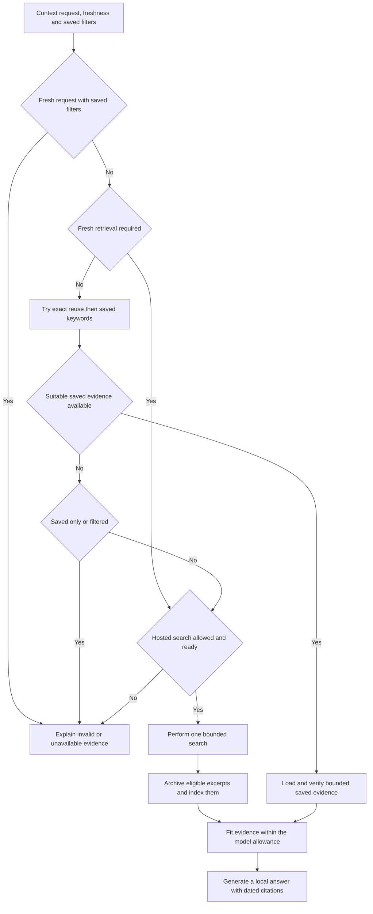

# Search context storage

Starting checkpoint, 2026-10-19: main `c63692f` includes archive configuration/ownership (#17), bounded metadata inventory and exact-version reads (#41), the automatically updating Evidence browser (#42), architecture #40 and PR #44's accepted Source archive settings/status and native setup/restart slice. That merged baseline passed 432 backend tests, 89 browser tests and the frontend build. This #22 branch adds the local candidate operation/API described below; saved-only/refresh chat modes, automatic chat capture and archive rebuild/delete endpoints remain planned.

PR #44 delivered #36's first slice through the existing persistent service. App-restart verification uses synthetic sources in a separate disposable store, never fixtures inserted into personal storage. A newly enabled empty archive gets its empty index during explicit setup; a missing index over existing captures remains unavailable rather than becoming a false empty result. The normal archive may honestly remain empty until acquisition wiring exists. This #22 branch adds bounded local candidates; the first saved-source pipeline (#23/#37/#24–#27) follows, while broader storage/accounting stays open in #36/#20. Searchable index #43 and graph #34 are optional. Old integration #8 and fixture PR #39 are closed as superseded; baseline #35 is verified. This branch adds no frontend changes, migration or personal-runtime deployment.

Historical preview context, 2026-10-04/07: an earlier integration used `C:\Users\malme\OneDrive\maestro\web-context`, exercised exact/keyword reuse and source modes, and recorded a tested hosted connection with `all_public` capture, a 1 TiB allowance, 200,000 items and a 24-hour reuse window. These are historical setup observations, not current main features, verified current quota or the proposed destination below.

Use OneDrive for eligible public source files and portable metadata. Keep live SQLite data, chat associations and query history in private local storage. The capture core can save eligible supplied excerpts; connecting it to the revised research acquisition path remains planned. Full source downloads are a separate increment.

## Alignment with the target research workflow

Architecture direction, 2026-10-16: the [target research workflow](ARCHITECTURE.md#target-research-workflow) starts with local database candidate retrieval. The orchestrator reviews candidates against each request requirement, accepts sufficient evidence and commissions searches for missing, stale or conflicting evidence. Newly acquired eligible evidence is stored before synthesis; the orchestrator then checks the draft against the original requirements. This workflow is planned; the browser, capture and local candidate APIs do not implement the reviewed loop.

The immediate storage target is a factual search database and its acquired results: private search/query/run records, acquisition parameters and outcomes, source references, dates, evidence selections and review decisions. The immutable archive and rebuildable index remain the storage foundation. Curated knowledge, entities/topics, associative relationships and their graph view are later layers over those records; personal memory remains a separate subsystem. Generated replies and inferred associations must retain their source references and remain distinguishable from acquired evidence.

Freshness is assessed for the particular requirement and the period covered by the facts, using available publication, retrieval and verification dates. A planned `stale_after` is a best-before threshold for current use, independent of future retention or eviction. Older evidence can remain appropriate for a historical requirement. Preserve complete eligible acquired content within acquisition and storage limits, then select relevant passages within the model's context allowance. Complete provider text still does not establish a complete origin document.

The `prefer_saved`/`refresh`/`saved_only` routing described in the historical sections below belongs to the older integration, not current main. The target uses database-first candidate review while preserving explicit freshness requests and network restrictions. Candidate availability alone never establishes that current evidence is sufficient.

## Local candidate lookup (#22)

This branch adds `ContextStore.lookup_candidates(query="", *, limit=10, domain=None, retrieved_from=None, retrieved_to=None, secrets=())` and authenticated `POST /api/context/search`. The API uses the normal session/CSRF protection and a strict JSON body: `query` defaults to an empty string, `limit` accepts integers from 1 to 20, `domain` is an optional exact public hostname, and retrieval bounds are optional inclusive UTC dates in `YYYY-MM-DD` form. A hostname does not include its subdomains. Private terms stay in the request body, outside request URLs; freshness/network options are not accepted.

Example request body:

```json
{
  "query": "quarterly revenue",
  "limit": 10,
  "domain": "reports.example.org",
  "retrieved_from": "2026-01-01",
  "retrieved_to": "2026-10-19"
}
```

Prefer matching private exact-query mappings, then search FTS title/text with at most 16 literal terms; an empty query uses filtered inventory. Operators cannot expand the generated FTS syntax. Apply the requested domain/retrieval dates and current source policy, retain stale/historical candidates, and deduplicate capture IDs rather than collapse distinct versions of a URL. Full saved source bytes are verified against immutable content/manifest pins before return; current eligibility and credential checks can withhold a whole candidate without rewriting its content or hashes. The existing source-object ceiling is 8 KiB; this operation does not introduce full-page capture or expand that storage limit.

Literal query terms and independent canonical-text matching use the existing index's default SQLite `unicode61` tokenizer. This preserves its case, combining-mark and legacy diacritic behavior for already saved captures. A bounded in-memory FTS5 table is discarded after lookup; its SQL work shares the lookup allowance. Persistent databases remain read-only, and original exact-query keys and archived bytes stay unchanged. See [SQLite's tokenizer compatibility rules](https://www.sqlite.org/fts5.html#unicode61_tokenizer).

The response envelope contains `state`, `candidates`, `skipped_count` and `search_limited`. States distinguish `ready`, `limited`, `disabled`, `unconfigured` and `unavailable`. Every returned candidate contains the verified saved-source projection, `body_verified: true`, `match_kind` (`exact_query`, `keyword` or `filtered`) and a mechanical `stale` flag based on the configured `reuse_hours`. Original retrieval/publication dates remain unchanged. A non-stale candidate, exact query or keyword match does not establish truth, currentness or acceptance for a requirement; #25 owns those decisions. Skipped or bounded results must not be treated as an exhaustive miss.

One lookup considers/verifies at most 200 candidates, sharing an approximately ten-million SQLite virtual-machine instruction allowance and a cooperative two-second deadline across its read work. SQLite values and private query mappings are bounded before fetching; source reads retain their existing byte/path/hash limits. Deadline checks do not interrupt a blocking filesystem read, so this is not a hard filesystem deadline. `search_limited` identifies incomplete search work; narrowing the query/filters can help.

Lookup makes no model or hosted call, writes no lookup/query records, and does not initialize, repair or migrate storage. API export rechecks current credentials and fences configuration/eligibility changes. Ordinary chat still permits its existing one hosted search and at most two answer-model calls; it neither reuses these candidates nor automatically captures hosted results. #43 can add searchable Evidence controls over the same operation later. Owned runs #23, shared model stages #37 and requirements/review/writing #24–#27 are the next research increments.

## Proposed factual search archive and lifecycle

The proposed fresh archive destination is `C:\Users\malme\OneDrive\Maestro-SearchArchive`. It holds complete eligible public returned content and immutable portable capture metadata. Canonical search/query/run SQLite records and derived keyword indexes stay in the configured local data directory, outside OneDrive. Private queries, user requests, decisions, generated answers and personal memories are not exported with public source files. The existing `web-context` folder can be ignored for this new archive; no import or migration is required. This is a proposed setup, not a runtime path change or directory creation, and no cloud capacity or offline availability is assumed verified.

Aim to retain as much complete eligible returned content as useful within independently configured acquisition and archive limits. The model's context allowance is a third, separate limit: 1,200 characters must not become an archive cap. Large or unusual payloads should produce a visible warning, while finite configurable response/object sizes, time and memory limits, archive byte/item allowances and free-space checks still protect capture. Refused, incomplete or unsaved acquisitions retain truthful outcomes and must not corrupt earlier versions. Record provider truncation when known; never describe a provider excerpt as a complete original page.

Select bounded passages relevant to each requirement from across the retained full text, rather than always using its first 1,200 characters. Bind each selected passage to its capture, source location and hash so coverage review, writing, final review and later replay use the same evidence. A small local full-text index and bounded passage selection are sufficient initially; semantic indexing and compression are not prerequisites.

| Planned field or status | Meaning |
| --- | --- |
| `stale_after` | Best-before threshold for a specified use or freshness policy; crossing it reduces current-use suitability or requires checking, without deleting content. |
| `eviction_due` | Optional input to a separate future retention/deletion process, not a freshness verdict or an instruction to delete immediately. No automatic eviction is introduced here. |
| Superseded, obsolete or disputed | A dated assessment with its reason and source references; preserve the earlier observation and distinguish outdated current-use information from valid historical facts. |

Reacquisition and later revalidation create new dated observations or checks. Corrections, contradictions and replacement evidence remain linked through version history; they do not rewrite pinned capture manifests, their hashes or earlier answers' evidence. New date evidence and lifecycle assessments belong in private records linked to immutable captures, or in explicitly versioned metadata with backward-compatible readers. Staleness alone never advances a retrieval date or erases an old result. Automatic eviction, compression and migration of the old folder remain outside this increment.

## Historical draft behavior and setup

The following sections record older draft/preview details and planned extensions from that design. They are reference material, not a dependency checklist or claims about current main. The old path, larger allowances, chat capture, historical finder/tool behavior, source replay and multi-lookup continuation must not be assumed present. This branch's narrow candidate API is defined above, even where the historical draft used the same endpoint path. The merged archive boundary is described in [ARCHIVE_POLICY.md](ARCHIVE_POLICY.md); the target above takes precedence over historical routing.

In that draft/local integration, `backend/web_search.py` retained complete sanitized provider extracts and `backend/context_store.py` captured them before final generation. Only `fit_sources` shortened model evidence to at most 1,200 characters per result and fitted escaped JSON into the allowance. The provider bound fitted evidence and hashes to the answer; disabled saving retained links-only provenance. A failed answer could leave reusable captures. Earlier links-only answers and truncated captures cannot recover discarded text without fresh acquisition. These details describe that older code, not current main search.

The hosted search response has a separate 64 MiB decoded-body allowance by default, read in 64 KiB chunks within the existing 30-second deadline. Set server environment variable `MAESTRO_SEARCH_RESPONSE_MIB` to a whole number from 1 through 1024 and restart to change this allowance; the native launcher also reads a saved Windows user value. Known-credential screening inspects complete bounded source fields, including encoded forms beyond the model excerpt. Oversized or invalid responses remain explicit failures. Download allowance, total archive capacity, result count and model context are independent. An archive object may contain up to 1 GiB of returned text; lowering the download setting does not invalidate existing larger captures. Objects retain `content_kind: search_excerpt` and `full_page: false`: complete provider text does not establish that the provider returned a complete origin page. New captures have `maestro_truncated: false`; historical shortened objects keep their original bytes, flags and hashes.

Online search readiness and source saving are separate. Search can succeed while saving is off, unavailable or excludes returned URLs; those citations remain unarchived. Enabling saving applies to future eligible search results and does not fill earlier citations retrospectively. A connection test always makes its fixed public hosted query and consumes allowance; eligible test results are captured only when saving is enabled under `all_public`. Tests do not fill the archive under `approved_sources`. Saved objects contain dated excerpts, not full downloaded pages.

Fresh configurations default to `capture_policy: all_public`, `enabled: false`, a 24-hour reuse window, 10 GiB and 200,000 files and directories. A configured mount alone grants no capture permission. Enabling **Save eligible public search results** authorizes saving eligible returned text without a per-site list. **Only approved URLs** remains available for restricted HTTPS collections. Persisted older configurations, or legacy API bodies omitting the policy, keep `approved_sources` and their existing limits; upgrading does not widen a collection automatically. Byte and item caps are configurable, with supported maxima of 10 TiB and 200,000 items. Reaching a cap stops additional capture without removing existing records. The size setting is an allowance rather than a disk reservation; actual free space is checked before capture. Automatic pruning and compression are not implemented.

The Settings view distinguishes indexed source snapshots from measured archive bytes and file/directory counts. The compact globe menu separates online readiness, saving status and source counters. Status measurements update on enabled configuration, capture, deletion and rebuild; they are not continuous filesystem polling. File totals include manifests, objects, format/claim files and staging artifacts; directories count toward the item cap but contribute no file bytes. The private index and query database are excluded. Deletion records can take usage above the capture cap. Configuration, deletion and rebuild permit recovery scans up to twice the supported item maximum, retaining the ten-second scan allowance; acquisition still enforces the configured byte and item caps.

The private SQLite index and FTS table retain searchable copies of complete captures, so they require space in addition to the archive files. Keyword lookup reads candidate metadata first, checks pinned object lengths before loading bodies, and verifies full text sequentially rather than materializing 201 full sources at once. Its 256 MiB aggregate evidence work allowance and existing time allowance may require narrowing keywords or filters for large collections. These lookup allowances do not shorten or remove durable objects.

`last_capture` describes the most recent bounded acquisition attempt, or is null before one is measured. It contains no query or private conversation text:

| Field | Meaning |
| --- | --- |
| `retrieved_at` | The original acquisition timestamp, not the time a saved result was reused. |
| `sources_received` | Number of returned entries considered within the configured one-to-three result allowance. |
| `sources_saved` | Entries whose immutable manifests and index rows were successfully published. |
| `excerpt_bytes` | UTF-8 bytes in those saved excerpts, including repeated excerpts that share an object. |
| `object_bytes` | Bytes in object files whose new publication completed successfully; deduplicated objects add zero. |
| `manifest_bytes` | Bytes in capture manifests whose new publication completed successfully. |
| `new_bytes` | Confirmed new object plus manifest bytes, including successful publications before a later indexing failure; excludes directories, format/claim files and private databases. |

These publication receipts are distinct from archive inventory. Staging cleanup can fail after a complete destination was linked, leaving final files and staging residue without confirming that publication. In that case the byte counters are lower bounds; zero confirmed bytes does not prove no files were written. `archive_bytes` measures logical file bytes, including final files and staging residue, rather than physical disk allocation.

Saved counts can be lower than received counts because of policy exclusions, storage limits or errors. At capacity, fitting sources remain reusable and refusals produce a warning; exact reuse returns only the verified saved subset. Unexpected publication/index failures can leave files but do not publish a new query mapping. Each successful fresh observation receives its own timestamped capture ID; exact/keyword reuse creates no new capture and does not refresh dates. Source removal suppresses evidence through a deletion record and normally increases stored bytes slightly; physical cleanup remains a separate future retention action.

The enabled archive offers one `search_context` tool independently of hosted readiness, so saved evidence remains usable without a search key, during cooldown or after the daily allowance is exhausted. A fresh miss still needs an enabled, tested hosted search with allowance. Explicit source requests cannot save an unsupported direct reply; fresh requests fail before inference when hosted dispatch is unavailable. Existing local-only generation, private-memory sharing restrictions, a configurable one-to-five source-lookup allowance, shared model accounting and context limits remain enforced. Private-memory conversations may retrieve local saved sources and cannot dispatch fresh hosted queries.

Relative days resolve once using the provider's local timezone. The server adds the resolved ISO dates to hosted queries without changing saved lookup queries or silently truncating a query that exceeds the cap. Final synthesis distinguishes a search retrieval timestamp from the date covered by source facts: snippets may be stale, and an undated forecast must not be described as verified for the requested day.

Recognized dated Local Ollama weather requests require source evidence even in **Prefer saved** without explicit search wording. Unavailable fresh-search setup fails before inference; a model that answers directly without using the source tool cannot commit its reply, and its consumed usage remains accounted. **Saved only** still permits local evidence without hosted dispatch. Explicit or resolved target dates prevent replaying older forecast bodies as the answer context.

Retrieved weather evidence passes a mechanical date gate before and after prompt fitting. Input supports relative days, ISO dates, full English/Swedish month-name dates and unambiguous numeric dates; ambiguous numeric forms require an ISO date instead of a guessed interpretation. A retained excerpt must contain each requested full calendar date, including a year, in its body. Dates in HTTP(S) links, the repeated title or recognized publication/update/retrieval metadata lines do not qualify. These weather controls apply to recognized dated local requests; ordinary nonweather and remote chat retain their existing behavior.

When no fitted excerpt qualifies, Maestro saves a server-authored inability-to-verify reply with source metadata and actual first-call usage, without a final synthesis call. Eligible archive captures remain available even when their forecast dates fail this check.

The gate checks date presence, not whether temperatures, location or other facts belong to that date; synthesis and source quality still need evaluation. For two requested days, each retained source must cover both: separate one-day excerpts are conservatively excluded rather than combined. Structured forecast/origin fetching remains a later increment.

The [development plan's verification record](../DEVELOPMENT_PLAN.md#search-context-milestone) covers bounded live capture, hash-bound readback and local follow-ups, plus an isolated network-disabled UID-1000 fixture under the supplied OneDrive root. The fixture verified write, flush, rename and read access; native and container SQLite both support FTS5. Its temporary resources were removed, and no live workspace records were copied into OneDrive. Hydration, cloud sync completion and pinned offline access remain unverified. Matching an excerpt does not independently verify its forecast or establish model quality.

## Storage layout

This is the existing preview layout. The proposed fresh archive uses the new root above while retaining the separation between public content files and private databases.

```text
C:\Users\malme\OneDrive\maestro\web-context\
  format.json
  objects\sha256\ab\<content-hash>.txt
  objects\sha256\cd\<content-hash>.html
  records\captures\YYYY-MM\<capture-id>.json
  records\checks\YYYY-MM\<check-id>.json   later origin validation
  records\deletions\<capture-id>.json
  writer-owner.tmp                         while this instance owns the archive

Private Maestro data directory or container /data:
  workspace.sqlite3             existing state, query mappings, answer references
  context\index.sqlite3         disposable source and full-text index
  context\rebuild.sqlite3       private resumable replacement and manifest queue
```

`format.json` identifies the archive and its schema version. Each capture manifest identifies its source, observation time, content kind and hash. Files named by a SHA-256 hash deduplicate identical bytes; a new capture remains a separate observation even when it refers to an existing object. Changed content creates a new version. Store extracted text separately from original HTML or PDF bytes and record the extraction version so it can be regenerated. First-stage archives contain text excerpts only.

Write and verify objects before publishing a capture manifest. Use unique temporary files on the archive filesystem and publish complete files without replacing an unrelated object. Update the local index and private query mapping after the manifest is durable. A crash may leave an unreferenced object or a capture without a query mapping; recovery can index valid captures without guessing lost query history. Hash mismatches, missing objects and incomplete sync are visible states, never usable evidence. Synced files may arrive in any order.

The archive is portable without its index. Rebuilding validates manifest schema and UTF-8 metadata, verifies referenced hashes and rebuilds capture records plus FTS5; corrupt records are counted and skipped. Document chunks follow full document capture. Reading online-only objects may trigger OneDrive downloads even without hosted search or model calls. First-stage rebuild operates on a pinned, locally available archive; report unavailable objects and bound each batch rather than silently hydrating an unbounded archive. Do not trust paths inside a manifest: require known relative object paths inside the selected archive, reject traversal and links that escape it, and bound every read. Ignore `desktop.ini`, staging files and unknown formats during import; count staging files toward storage limits. Do not execute or render source HTML as application content.

Index reconstruction is resumable rather than capped at a single batch. `POST /api/context/rebuild` accepts `limit` (1–5,000 records per batch, default 1,000) and an optional `continuation` job ID. Status and responses expose `rebuild_progress` with `id`, `processed`, `total` and `complete`; processed records include missing or corrupt captures. The private queue and progress survive restart. Settings runs sequential batches and can pause after the current response or continue an existing job. The published index remains usable until the replacement is complete and atomically installed. Capture, deletion or configuration changes invalidate an unfinished job; external capture-path changes prevent stale publication. Inventory scans and batch work remain bounded, so slow or incompletely hydrated archives may require local availability and retry. No hosted or model call occurs during reconstruction.

Start with one archive writer on this computer. An exclusive, token-checked `writer-owner.tmp` claim enforces ownership independently of the private workspace lock, including instances with different data directories. The running application holds it while enabled; archive mutations share one lock. An unclean shutdown can leave a claim: stop every old writer before explicitly removing that exact claim and retrying. Do not automatically reclaim it based on a PID or clock. OneDrive synchronizes files rather than application transactions; immutable records reduce conflicts but do not provide multi-device locking. Concurrent writers on different computers and automatic conflict resolution are unsupported.

A deletion record immediately suppresses a capture in the live index, exact-query mappings and saved-source API. Rebuild/import applies deletions before serving results and preserves that suppression when old captures arrive later. Earlier answers retain their citation metadata; opening the saved snapshot reports that it is unavailable or removed. Do not silently recreate the deleted source. Physical cleanup requires object reference checks, including private answer associations without exporting them, and an explicit retention action. Keep deletion records while older captures can reappear. OneDrive's cloud copies and recycle bin have their own deletion lifecycle.

This separation is an architectural choice based on database consistency and asynchronous file sync. SQLite WAL has associated files that belong with the database; OneDrive is not being classified as a network filesystem. Keep the index outside sync and initially use rollback journaling with one writer. Introducing concurrent WAL requires checking the bundled SQLite version against its documented WAL reset fix. [SQLite WAL documentation](https://www.sqlite.org/wal.html).

## Source identity and dates

| Field | Meaning |
| --- | --- |
| `capture_id` | Stable identity of one observed source version. |
| `source_url` | Exact eligible public URL supplied by the provider or requested from the origin. |
| `final_url` | Observed final origin URL, if available; unknown for the present search response. |
| `source_id` | Identity derived from a conservatively normalized URL. |
| `content_kind` | `search_excerpt`, `provider_extracted_text`, `origin_html`, `origin_pdf` or extracted text linked to an original. |
| `content_hash` | SHA-256 of the stored bytes, with length, encoding and media type. |
| `manifest_hash` | Canonical metadata digest recorded in the private index, query references and citations, binding the source identity and dates as well as its bytes. |
| `completeness` | First increment records Maestro's excerpt truncation and `full_page: false`; provider-side truncation is unknown. Later captures add retained length/limit and origin completeness. An excerpt never becomes a full document. |
| `retrieved_at` | UTC timestamp when Maestro successfully received this content. Reuse never changes it. |
| `published_at` | Publisher's declared publication date, if supported by source evidence. |
| `modified_at` | Publisher's declared content update date, if supported by source evidence. |
| `http_metadata` | For origin captures only: selected response status, validators, HTTP date, cache policy and representation headers, distinct from publisher dates. |
| `last_verified_at` | Derived from successful origin checks of this exact representation; null for search excerpts. |
| `date_evidence` | Raw date values, their source and precision, plus conflicting candidates where relevant. |
| `acquisition` | Provider/method and extraction/schema versions; no credentials or request prompts. |

Eligible URLs under `all_public` may use public HTTP or HTTPS with their normal ports. `approved_sources` scopes remain HTTPS-only. Both use conservative host casing/IDNA and default-port normalization; scheme, path and the complete query remain part of identity. Credentials, fragments, unsafe URL characters and private/internal destinations are rejected. Query parameter order, values and encoding are preserved; do not equate different query strings, trailing slashes or publisher canonical links without evidence. These are returned search snippets: Maestro makes no network request to their origin URLs, so accepting an HTTP link does not add an origin-fetch transport. Future full downloads keep their separate HTTPS/DNS boundary.

Under `all_public`, eligible unlisted public sources are saved without per-site approval. Dynamic URL checks exclude obvious authenticated/private paths and credential, signed, session or personal query forms, including encoded sensitive parameters and known credentials. Bounded decoding checks percent-encoded, HTML-escaped and mixed encodings in URLs, titles and bodies before model use or export. Checks retain the key used by an in-flight search across rotation and include the configured provider key. Existing literal redaction remains in place; encoded credential-bearing entries are excluded. These checks are conservative filters, not proof that every page behind a public URL is public: hosted excerpts have no origin authentication or cache headers. Private-memory context, hosted acquisition queries and full prompts never belong in the synced archive.

Under `approved_sources`, capture additionally requires exact HTTPS origins with public path scopes or explicitly approved complete query URLs. An ordinary site/path scope never grants query-bearing URLs. For example, approving `https://weather.example.org/forecast?location=Stockholm&date=2026-10-05` permits only that complete normalized URL; another date, extra parameter, reordered query or different encoding needs its own approval. An exact query URL does not grant its site's other pages. Ineligible results remain transient; citations identify that they were not saved. Changing or narrowing the policy invalidates private query mappings and makes newly ineligible snapshots unavailable without rewriting their immutable files.

Observation timestamps use timezone-aware UTC. Publisher dates retain their actual precision: a date without a time remains a date, with no invented midnight or timezone. Publication date, modification date, HTTP `Last-Modified`, server `Date`, retrieval time and an event discussed in the article have separate meanings. Missing publication dates remain unknown. A model must not supply a guessed date to the index. For webpage captures, record explicit publisher metadata or labelled text and its extraction location; keep conflicts visible. Structured `datePublished` describes publication, while `dateModified` describes modification. [Schema.org CreativeWork](https://schema.org/CreativeWork). Store HTTP `Date` and `Last-Modified` separately: the former describes message origination, the latter the server's selected representation. [RFC 9110](https://www.rfc-editor.org/rfc/rfc9110.html#section-8.8).

The exact excerpt manifest contract is defined by [`validate_capture_manifest`](../backend/context_policy.py). `manifest_hash` is derived and retained in private references, not inserted into the public manifest.

Origin verification is recorded in a separate immutable check referencing the capture, URL, time, response status and validators. A successful conditional `304` can verify the matching representation without downloading it again. A changed `200` creates a new capture; an unchanged response can refer to existing bytes. Failures and cache reuse do not advance verification time. Verification establishes what the origin served or validated, not factual correctness. Record validator strength: weak ETags can validate semantic equivalence without proving byte identity. Do not describe their `304` response as an exact-byte comparison.

Ollama documents search results as snippets and its separate `web_fetch` response as main content plus links. The documented response does not expose origin validators, headers or a final URL. If that service is added, label its output `provider_extracted_text` and its retrieval time accurately; do not claim a raw webpage snapshot or origin verification. Give hosted fetch its own explicit reservation, request cap and timeout rather than treating it as an uncounted part of the source-lookup allowance. [Ollama web search and fetch](https://docs.ollama.com/capabilities/web-search).

## Retrieval and freshness

The diagram and mode rules describe historical draft #8/local-integration cache routing, not current chat. That draft's cache choices are reference material; the planned database-first review above defines the revised direction. This #22 branch adds the separate candidate endpoint described above, without these chat modes or automatic cache acceptance.



Use explicit request modes: `prefer_saved`, `refresh` and `saved_only`. First try an exact normalized-query match, with provider, result limit and schema included in the key; on a miss, try saved keyword retrieval. Normalization may trim and collapse whitespace; it must not remove dates or change query meaning. Store exact-query mappings and raw acquisition queries only in private SQLite. Unchanged settings saves and numeric cap/reuse-window edits preserve mappings; lookup still applies the current reuse window and source eligibility. Enabled-state, policy or approved-scope transitions clear mappings. Keyword lookup is read-only and does not add mappings or write the archive. Do not cache failed searches as useful evidence. Search connection tests always bypass saved reuse; capture of their fresh public results follows the enabled `all_public` rule above.

That draft's chat API accepted `context_mode`, with globe-menu choices **Prefer saved**, **Fresh search** and **Saved only**. Its **Search options** popup showed online readiness, saving status and source counters. The tool-selection call supplied typed freshness (`stable`, `current` or `unspecified`). The draft enforced saved-only network prohibition, refresh bypass and stable-only ordinary reuse. These are historical controls, not options currently offered by main. Any replacement must still preserve explicit freshness and no-network instructions; readiness does not imply saving or authorize a source.

The local integration's **Maximum source lookups per message** setting accepted one through five, defaulting to five. Both saved lookup and fresh acquisition consumed that allowance, while only hosted attempts consumed daily quota. The integration captured eligible results before continuing and retained combined citations, queries and restriction notices. This setting is not on main, whose current chat path permits one hosted-search round.

These request controls were implemented in historical draft #8/local integration, not current main. Explicit `refresh` and `saved_only` required evidence-tool use; unsupported direct answers retained usage without being saved as sourced answers. That draft combined typed freshness with a conservative English/Swedish recency guard and labelled old saved-only evidence stale. Its guard was not a complete semantic classifier. Publisher dates remained unknown, and `maestro_truncated` described only Maestro's cutoff, not provider completeness.

Recognized English/Swedish instructions prohibiting a new online search fence hosted dispatch independently of the model's freshness output; a conflicting **Fresh search** choice fails before inference. An explicit rewrite of earlier evidence may reuse its verified fitted body, including a dated request only when that body supports the requested date. An unrelated new topic receives saving status without replaying old source bodies and may use the normal evidence tool and permitted fresh fallback. Merely enabling the archive does not exclude an ordinary offline, source-free exchange from memory curation; actual source assistance and available hosted dispatch retain that exclusion.

Rewrites follow the latest assistant answer's own source provenance. Chained rewrites resolve its original message/source/hash references and reuse only the fitted source subset actually supplied to that answer. Older unrelated searches contribute metadata, not bodies; a latest unsourced reply retains normal source-tool fallback. Missing pinned evidence remains unavailable and does not permit replaying another prior report's body or hosted fallback. Negative instructions about another object, such as “Använd inte Fahrenheit”, do not prohibit searching.

Before saved lookup or prior-source evidence reaches synthesis, current known credentials are checked with the same bounded decoding used during acquisition. Unsafe titles/URLs are withheld from prior-source records and unsafe bodies are not replayed. Saved tool results exclude credential-bearing entries without changing their immutable bytes or hashes. Immediately before each inference, the server rechecks its retained source packet and, for final synthesis, the newly fitted evidence. A key change during metadata, planning or source validation can therefore stop the next call while retaining captures and any consumed first-call usage. Ordinary user/history text is outside this source-evidence check.

The default reuse window is a configurable 24 hours, an application default rather than a freshness guarantee. Requests for current prices, latest releases or other changing facts require refresh. An explicit user refresh bypasses the query cache. Refreshing known URLs does not discover newer pages or events: latest-information requests require fresh discovery as well as validation of selected sources when origin fetching exists. If fresh retrieval is unavailable, explain that and offer saved evidence with its age; never silently present it as current. `saved_only` can return older matches with a visible stale label and no network call. A recent search excerpt still does not prove recent publication or that the underlying page was fetched.

Historical draft #8/local-integration keyword retrieval used the FTS5 title/text index with one to sixteen literal keywords, all-term matching and stronger title weighting. Operators could not alter generated query syntax. This found shared subject terms without semantic inference; candidates still needed request-specific assessment. The #22 operation above is a separate narrow implementation over the existing FTS tables, without the historical chat routing or version-suppression rules below. Ranking can reuse SQLite's documented functions. [SQLite FTS5](https://www.sqlite.org/fts5.html).

Optional filters accept an exact public hostname and inclusive UTC dates in `YYYY-MM-DD` format for **retrieval**, independently of unknown publication dates. A hostname does not include its subdomains. Apply dates, TTL and scope eligibility before selecting a source version; a newer eligible verified observation at the same URL suppresses an older keyword match even when the new text no longer contains those terms. A historical date range can deliberately select the older version. Missing, deleted, tampered or out-of-scope evidence is excluded. Preserve each returned capture's original content/manifest hashes and date; lookup execution time does not become a new retrieval date.

Filtered tool requests skip unfiltered exact-query reuse and cannot fall back to hosted search. A request combining saved filters with required freshness fails explicitly; use saved-only for historical filtered evidence. Unfiltered stable requests may try exact reuse, then keyword retrieval, then an allowed fresh search on a miss. Current/uncertain requests and forced refresh bypass both saved paths. Each source must fit the reuse window unless saved-only is selected; future-dated captures are excluded.

The draft's **Settings → Saved web sources → Find saved sources** provided manual keyword lookup, bounded results and domain/retrieval-date filters, opening a hash-bound viewer. Its `POST /api/context/search` kept private terms out of URLs, made no model/hosted call or archive write, and did not initialize or repair an index. The new #22 branch reuses that path for the distinct candidate contract above; it does not restore the Settings finder or historical response/routing contract. The merged Evidence page remains a metadata browser; #43 can add a searchable view over the revised operation without importing this old UI.

Saving an eligibility change (enabled state, capture policy or approved scopes) revalidates an open source view and discards pending responses from the previous policy, including when an unrelated workspace refresh fails. Confirmed deletion makes the source unavailable in current and reopened views; pending reads cannot restore its text. Unsaved drafts, byte/item caps and reuse-window changes do not close an eligible view. Pending Settings saves and drafts survive navigation, preventing later numeric edits from restoring old permissions. Archive controls dispatch actions in order; a rebuild must pause or finish before another archive action starts. Source viewing and keyword lookup remain available during reconstruction.

Lookup accepts at most 20 returned sources (chat keeps its existing one-to-three result allowance). It considers up to 200 distinct candidate URLs and verifies at most 200 version rows, giving each URL's newest eligible observation priority before older fallback versions. SQLite work is bounded by a two-second progress deadline and approximately ten million virtual-machine instructions; these checks do not interrupt a blocking filesystem read, so the offline archive must still be locally available. `search_limited` marks remaining candidates or unresolved versions. Partial or empty bounded results carry a narrowing hint; an unfiltered preferred-saved request may still use an allowed fresh search and disclose that local lookup reached its limit. Deadline/instruction exhaustion produces a fixed narrowing diagnostic rather than a corruption claim.

Local lookup requires neither a hosted key nor a hosted-search allowance. Model calls still use the existing generation slot and token ledger. Fresh search retains its existing reservation, caps, cooldown and privacy checks. Exposing a local archive tool must not enable hosted dispatch from a conversation containing private memory. Settings permit one to five source lookups per message, defaulting to five. Saved lookups consume that message allowance but not the daily hosted-search allowance. Sequential answer calls share the existing reply and cumulative token allowances. At the cap, stop tool execution, synthesize from collected evidence and disclose the restriction; a model that continues requesting tools cannot discard the answer and its sources. There is no background refresh crawler.

Archive eligible, sanitized excerpts immediately after a successful search, before final model generation. If the answer fails, the source capture remains reusable and consumed model/search usage remains recorded. If saving fails or eligibility excludes a source, show that evidence was not saved; a bounded transient answer may still proceed. Transient citations retain the live URL, retrieval date, kind and `not_saved` status, with no capture ID or saved-source view. Do not record a saved citation unless its capture exists.

For saved evidence, record each answer's capture IDs, content/manifest hashes and the exact excerpt text and hash actually supplied to the model in private storage; transient evidence uses the exception above. Saved views pass both historical hashes. Validate source eligibility and deletion before final dispatch, then guard the short answer commit with the archive mutation lock. Deleted, changed or newly out-of-scope evidence rejects a late result while preserving consumed usage. A later refresh must not change an earlier answer's references. Citation details show the live URL, a saved text view when available, content kind, retrieval date, optional publisher dates and origin verification when available. Keep the existing numbered citation style. Display stages such as “Checking saved sources”, “Using sources saved on 4 October” and “Searching the web” only when the corresponding work occurs; the planned chat-run events can carry these stages later.

## Local follow-ups and coordinator selection

For local follow-ups, the provider constructs a bounded source record from server-held status and up to two source reports, prioritizing the latest answer's own report and its exact earlier source references. Each report has at most three source entries, within a 4,096-byte serialized allowance. It exposes actual saving status, original retrieval dates and hash-checked fitted excerpts when available; missing or omitted evidence is labelled. Saved bodies must still match their pinned content/manifest hashes and recorded excerpt prefix. Recheck saved sources before inference and at answer commit, so deletion, tampering or policy changes fence delayed replies.

Ordinary rewrites and questions about prior sources can reuse this local evidence without hosted dispatch. Current lookup and replayed excerpts share one per-answer citation list while retaining their original message/source/hash references. A rewrite without a lookup shows sources from earlier answers and records no new search. Recognized historical weather bodies are withheld when their requested dates are missing/invalid or the fitted excerpt fails the date check, while saving/availability status remains visible. Instructions require preserving the source's values and distinguishing recorded saving status from current availability. Fresh/current, explicit source requests and recognized dated weather requests use the existing freshness/tool path instead of replaying old bodies as current evidence. The source record remains private model context, never a hosted query. Generated JSON has no file-writing authority: capture occurs in the backend after an eligible search acquisition. These instructions do not guarantee the model's semantic accuracy.

Local `chat_routing: orchestrator` selects the configured installed orchestrator model for ordinary `role: chat` messages unless a per-message choice overrides it. Direct routing remains the legacy default. Both routes use the same shared slot, bounded context, output allowance and configurable one-to-five source lookups per message. This does not implement a separate typed assessment, progress-event service or specialist delegation; see the [chat design](CHAT_ORCHESTRATION.md).

## Full source downloads

After excerpt reuse works, add explicit or policy-selected downloads of bounded public HTML/text sources used in an answer. Keep original response bytes and separately extracted readable text. Add PDF capture/extraction only with bounded CPU, memory, file size and parser time. Do not recursively follow page links or automatically download every result. Proposed first limits are three selected sources, 5 MiB each for wire bytes and decoded document bytes, 1 MiB extracted text, no redirects and 30 seconds per fetch within a 90-second cumulative fetch deadline. These limits require validation against the container's memory and storage policy. Capture work must also fit its parent run's remaining deadline.

Direct origin fetching needs a new security boundary. The current `safe_url()` validates links without resolving DNS. Initially allow only HTTPS on port 443 with redirects disabled. Validate all IPv4 and IPv6 DNS answers, reject credentials and non-public/internal destinations, and ensure the actual socket connects to a validated address while preserving TLS hostname checks. Merely validating DNS and then allowing an HTTP client to resolve again leaves a rebinding gap. If redirects are introduced, cap them at three, repeat all checks and connection pinning at each hop, and prohibit HTTPS downgrade. Keep proxies disabled, separate origin requests from provider authorization headers, and send no private prompts, cookies or workspace identifiers. Use a controlled resolver/connection implementation or constrained egress rather than weakening the existing filter. The [OWASP SSRF prevention guidance](https://cheatsheetseries.owasp.org/cheatsheets/Server_Side_Request_Forgery_Prevention_Cheat_Sheet.html) documents DNS and redirect hazards.

For direct HTTP reuse, preserve selected validators and cache metadata, including `Age`, expiration and representation choices such as `Vary` and the relevant non-sensitive request headers. Conditional requests use `ETag` or `Last-Modified`; validation results refer to the matching stored representation. As an application policy, skip durable capture for `no-store` and authenticated/private responses. HTTP reuse of `no-cache` requires successful validation; `must-revalidate` requires it once stale. Explicit historical saved-source viewing identifies a past observation rather than a validated current response. Store no arbitrary response headers such as cookies. [RFC 9111 HTTP caching](https://www.rfc-editor.org/rfc/rfc9111.html).

Treat every downloaded document as untrusted evidence. Archive viewing returns safe text or a download through an authenticated API, never arbitrary paths, scripts or instructions granting tools. Future summaries are derived artifacts with links to source versions, not replacements for the evidence.

## OneDrive and deployment

For the current native setup, use the [Windows archive instructions](WINDOWS_BACKGROUND.md#permanent-source-archive-on-windows) and inspect Source archive settings. Path selection is explicit; documentation does not change active paths or migrate old content. Restart checks use a separate disposable fixture store. The container/deployment details below describe the historical preview and are not an implemented archive-mount launcher.

The historical integration uses an opt-in archive path independent of `MAESTRO_DATA_DIR`, with `MAESTRO_CONTEXT_ARCHIVE_DIR` and an explicit `-ContextArchivePath` in its Windows container launcher. Its launcher resolves the selected host directory, mounts it at `/archive`, fingerprints the configuration and verifies ownership on restart. Its index stays at `/data/context/index.sqlite3`. Mounting belongs to the separately reviewed launcher/storage configuration work; the revised read-only Evidence view does not require importing the full old launcher flow. See the [container runbook](CONTAINERS.md) and [native setup](WINDOWS_BACKGROUND.md#application-lifetime-and-startup), with the integration-only archive details retained on draft #8 until extracted.

The observed Podman machine sees the Windows directory through `/mnt/c`, but mount sources belong to the selected machine/server. Do not assume that mapping for another WSL distribution or a remote connection. Verify the Windows path, machine path, UID 1000 read/write access and rename behavior on this setup before enabling capture. Do not use recursive ownership changes on the OneDrive tree. [Podman volume reference](https://docs.podman.io/en/latest/markdown/podman-run.1.html).

OneDrive online-only files need downloading before local use; files marked “Always keep on this device” remain available offline and consume disk space. Pin the active archive if offline access is required, or report missing local objects rather than treating their filenames as usable content. Test actual behavior with Windows and the container, including loss of connectivity. This design does not add unattended pinning or eviction. [Microsoft Files On-Demand](https://support.microsoft.com/en-us/onedrive/save-disk-space-with-onedrive-files-on-demand-for-windows).

OneDrive is a cloud-synced archive. Export only eligible public source content and portable source metadata. Queries, chat IDs, private memories, generated answers, provider ledgers and credentials stay in private local storage. Do not assume a public hostname makes personalized search output public. Sources containing personal, authenticated or uncertain content require separate local handling and must not be exported by the public archive feature.

Check free local space, an archive size allowance and a file-count allowance before capture. Many small capture/check records can reach sync performance limits before using much cloud capacity. Use short names and shard record directories by month; measure larger archives before adding immutable packed batches. [Microsoft OneDrive limits](https://support.microsoft.com/en-us/onedrive/restrictions-and-limitations-in-onedrive-and-sharepoint).

Failure or a full disk must not damage existing versions. Expose archive size and item count, indexed/missing/corrupt counts, oldest retrieval and last indexing error. Keep logs to IDs, status and bounded diagnostics. Index rebuild is explicit and bounded, and never calls a model. Sync is not an independent backup; the existing private SQLite snapshot procedure remains separate.

## Implementation increments

The development plan's [current delivery sequence](../DEVELOPMENT_PLAN.md#next-delivery-sequence) owns active work. Its [SEARCH-01 through SEARCH-05 table](../DEVELOPMENT_PLAN.md#search-context-milestone) labels the historical milestones separately.

The historical preview exercised SEARCH-01 through SEARCH-03. Merged main includes the smaller capture/configuration/read-only Evidence foundation and PR #44's first #36 setup/status/restart slice; this branch adds #22 candidates before the saved-source research loop. Remaining #36/#20 storage/accounting work stays open. Full documents and semantic retrieval remain later work with transport, parser and measured-quality requirements. Automated checks establish synthetic behavior, not hosted source truth or OneDrive sync/offline behavior.

Verification must include interrupted writes, objects arriving after manifests, schema mismatch, tampering, failed indexing after capture, immediate deletion/cache invalidation followed by out-of-order rebuild, archive unavailable/full/partly hydrated, container recreation and the memory/hosted-search boundary. Include a latest-information fixture where a saved page returns `304` but a newer source exists elsewhere. Use synthetic responses with distinct publication, retrieval and verification dates. No tests need a personal key, paid request, live model or real chat content. Inspect citation dates and saved-source viewing in the browser when those controls exist.
